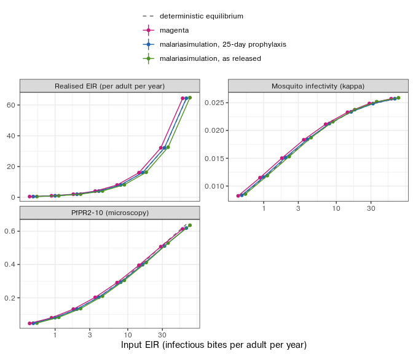
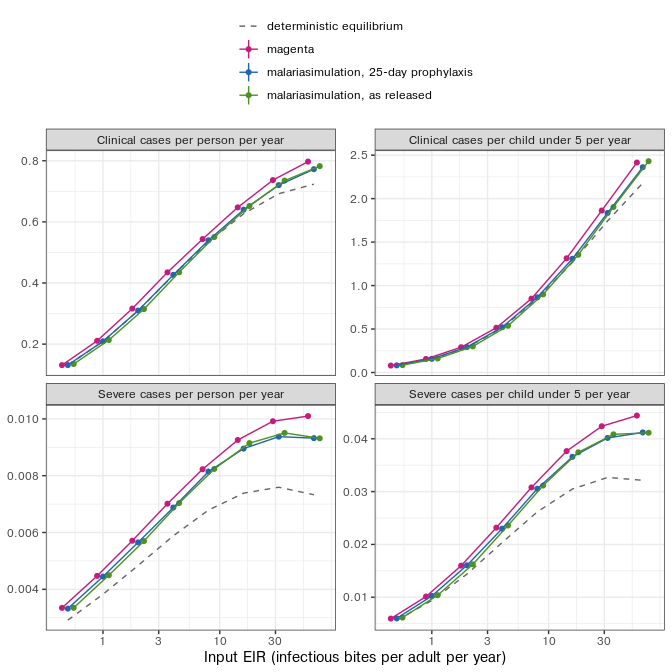
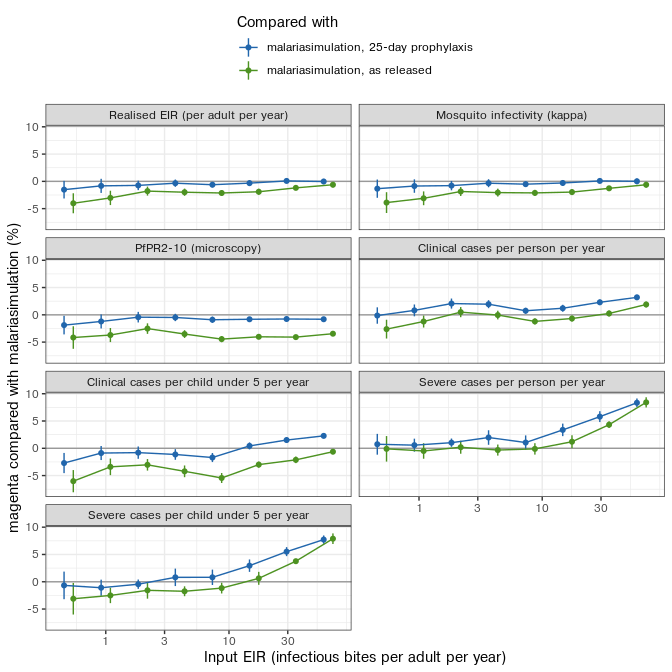
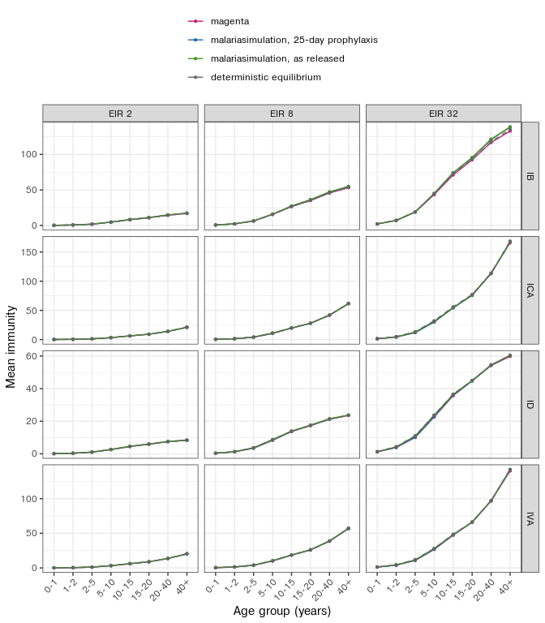
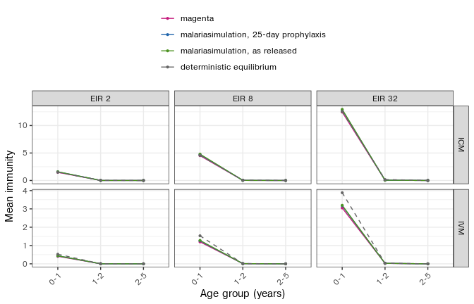
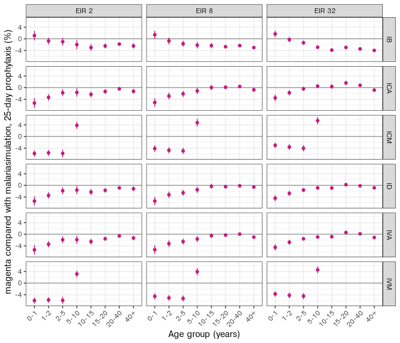
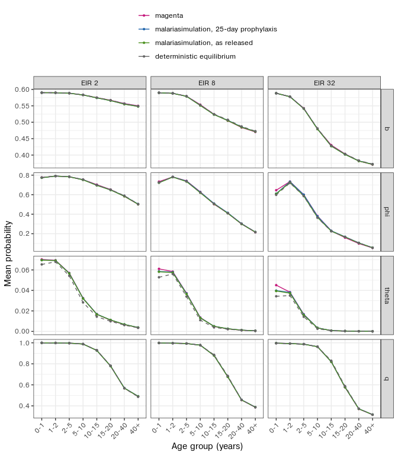
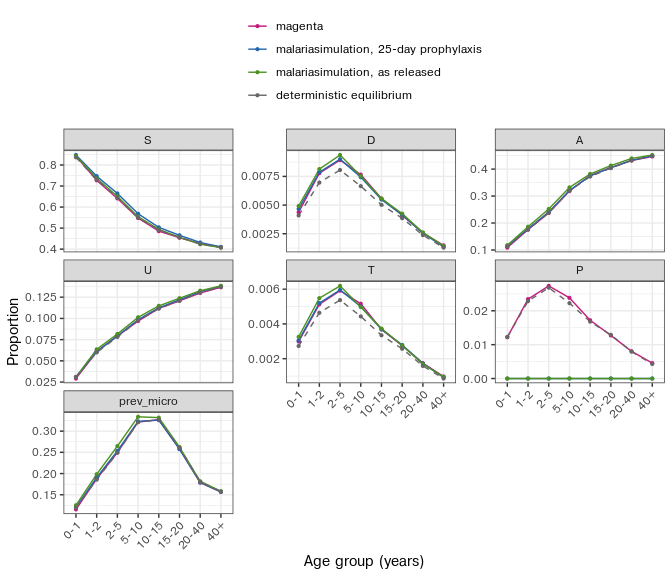

## Overview

`magenta` and [malariasimulation](https://github.com/mrc-ide/malariasimulation)
are both individual-based versions of the Griffin et al. model of *P.
falciparum* transmission, and both start from its deterministic equilibrium.
Given the same EIR and the same treatment they should give the same
transmission, prevalence, incidence and immunity. This vignette compares them
across a range of transmission intensities, and is the place to rerun the
comparison after changes to the transmission or immunity code.

The simulations are too large to run when building the package, so they were
run on a cluster and the code is shown here without being evaluated. The
scripts are in `vignettes_src/equivalence/` in the package repository, and the
summarised results that make the figures below are in
`vignettes_src/equivalence_summary.rds`.

## Set up

The models are run in matched perennial settings:

* the same input EIR (0.5 to 64), with no seasonality and no vector control,
* 40% of clinical cases treated (`ft = 0.4`), with a drug that always clears
  infection, as `magenta` has no drug failure unless resistance is modelled,
  and no treatment of non-malarial fevers,
* 100,000 people for 10 years, 10 runs for each EIR and model.

The models start from their equilibrium, but malariasimulation takes 3 to 4
years to settle, so all outputs are averaged over years 4 to 10. The
uncertainty intervals are the mean plus or minus 1.96 standard errors across
the 10 runs.

There are three models compared to `magenta`:

* **malariasimulation, 25-day prophylaxis** (the main comparison). In
  `magenta`, as in the deterministic model, treated people are protected from
  reinfection for 25 days on average. malariasimulation's default drug
  protects for about 10 days, so here its protection is set to be exponential
  with a mean of 30.5 days from treatment (5 days in treatment, then 25 days).
* **malariasimulation, as released**, with its default drug protection.
* **the deterministic equilibrium**, with fine age groups.

malariasimulation rounds a few of the published parameters (e.g. `b0` 0.59
rather than 0.590076), so these are set to `magenta`'s values. The two models
then differ only in how quickly maternal severe immunity decays (`magenta`
uses its own rate, while malariasimulation uses the maternal clinical immunity
rate) and in how severe cases are counted (`magenta` sums each person's
probability of severe disease, malariasimulation draws them).


``` r
library(malariasimulation)

FT <- 0.4
mpl_default <- magenta::model_param_list_create()

malsim_params <- function(eir, N, p25 = FALSE) {
  r <- list(human_population = N)
  # align malariasimulation to magenta's parameter values
  mp <- mpl_default
  r$average_age <- 1 / mp$eta; r$du <- 1 / mp$rU; r$cd <- mp$cD; r$cu <- mp$cU
  r$ct <- mp$cT; r$ad <- mp$aD; r$b0 <- mp$b0; r$ib0 <- mp$IB0; r$kb <- mp$kB
  r$ub <- mp$uB; r$phi0 <- mp$phi0; r$phi1 <- mp$phi1; r$uc <- mp$uCA
  p <- get_parameters(r)

  # a drug that always clears infection
  al <- AL_params
  al[1] <- 1
  # 25 days of prophylaxis after the 5 days of treatment, as in magenta
  if (p25) {
    al[3] <- 1
    al[4] <- 30.5
  }
  p <- set_drugs(p, list(al))
  p <- set_clinical_treatment(p, 1, 1, FT)
  set_equilibrium(p, eir)
}
```

`magenta` is run with `pipeline()`, saving the state every 73 days so the
immunity of each person can be summarised over time.


``` r
library(magenta)

out <- pipeline(EIR = eir, N = 1e5, years = 10, ft = FT, num_loci = 2,
                seed = seed, update_save = TRUE, update_length = 73,
                update_save_func = save_fn)
```

The full run functions, which also record the mean immunity, infection state
and probability of infection, clinical and severe disease of each age group,
are in `vignettes_src/equivalence/funs_forensic.R`.


``` r
library(ggplot2)

res <- readRDS("equivalence_summary.rds")
res$meta[c("magenta_sha", "malariasimulation", "N", "reps", "years",
           "window_years")]
## $magenta_sha
## [1] "1d424e6813a559739f8a4dee288aac3ea42d6065"
## 
## $malariasimulation
## [1] "v3.0.0"
## 
## $N
## [1] 1e+05
## 
## $reps
## [1] 10
## 
## $years
## [1] 10
## 
## $window_years
## [1]  4 10

model_labels <- c(magenta = "magenta",
                  malariasimulation_p25 = "malariasimulation, 25-day prophylaxis",
                  malariasimulation = "malariasimulation, as released",
                  deterministic = "deterministic equilibrium")
model_colours <- setNames(c("#c51b7d", "#2166ac", "#4d9221", "grey40"),
                          model_labels)
bands <- c("0-1", "1-2", "2-5", "5-10", "10-15", "15-20", "20-40", "40+")

tidy <- function(d) {
  d$model <- factor(model_labels[d$model], levels = model_labels)
  if ("band" %in% names(d)) d$band <- factor(d$band, levels = bands)
  d
}
headline <- tidy(res$headline)
immunity <- tidy(res$immunity)
states <- tidy(res$states)
```

## Transmission, prevalence and incidence


``` r
outcome_labels <- c(
  realised_EIR = "Realised EIR (per adult per year)",
  kappa = "Mosquito infectivity (kappa)",
  `PfPR2-10` = "PfPR2-10 (microscopy)",
  clinical_all = "Clinical cases per person per year",
  clinical_u5 = "Clinical cases per child under 5 per year",
  severe_all = "Severe cases per person per year",
  severe_u5 = "Severe cases per child under 5 per year"
)

plot_outcomes <- function(outcomes) {
  d <- headline[headline$outcome %in% outcomes, ]
  d$outcome <- factor(outcome_labels[d$outcome], levels = outcome_labels)
  sims <- d[d$model != "deterministic equilibrium", ]
  ggplot(sims, aes(EIR, mean, colour = model)) +
    geom_line(data = d[d$model == "deterministic equilibrium", ],
              linetype = "dashed") +
    geom_pointrange(aes(ymin = lo, ymax = hi), size = 0.2,
                    position = position_dodge(width = 0.15)) +
    geom_line(position = position_dodge(width = 0.15)) +
    facet_wrap(~outcome, scales = "free_y", ncol = 2) +
    scale_x_log10() +
    scale_colour_manual(values = model_colours) +
    labs(x = "Input EIR (infectious bites per adult per year)", y = NULL,
         colour = NULL) +
    theme_bw() +
    theme(legend.position = "top", legend.direction = "vertical")
}
```

The dashed line is the deterministic equilibrium.


``` r
plot_outcomes(c("realised_EIR", "kappa", "PfPR2-10"))
```

<!-- -->


``` r
plot_outcomes(c("clinical_all", "clinical_u5", "severe_all", "severe_u5"))
```

<!-- -->

The deterministic severe incidence is left out, as it can only be calculated
approximately from the equilibrium.

### Differences from malariasimulation

The percentage difference of `magenta` from malariasimulation, with 95%
intervals.


``` r
pct <- res$pct_headline
pct <- pct[pct$outcome %in% names(outcome_labels), ]
pct <- rbind(
  data.frame(EIR = pct$EIR, outcome = pct$outcome,
             model = model_labels[["malariasimulation_p25"]],
             pct = pct$pct_magenta_vs_ms_p25, lo = pct$lo_magenta_vs_ms_p25,
             hi = pct$hi_magenta_vs_ms_p25),
  data.frame(EIR = pct$EIR, outcome = pct$outcome,
             model = model_labels[["malariasimulation"]],
             pct = pct$pct_magenta_vs_ms, lo = pct$lo_magenta_vs_ms,
             hi = pct$hi_magenta_vs_ms))
pct$outcome <- factor(outcome_labels[pct$outcome], levels = outcome_labels)

ggplot(pct, aes(EIR, pct, colour = model)) +
  geom_hline(yintercept = 0, colour = "grey60") +
  geom_pointrange(aes(ymin = lo, ymax = hi), size = 0.2,
                  position = position_dodge(width = 0.15)) +
  geom_line(position = position_dodge(width = 0.15)) +
  facet_wrap(~outcome, ncol = 2) +
  scale_x_log10() +
  scale_colour_manual(values = model_colours) +
  labs(x = "Input EIR (infectious bites per adult per year)",
       y = "magenta compared with malariasimulation (%)",
       colour = "Compared with") +
  theme_bw() +
  theme(legend.position = "top", legend.direction = "vertical")
```

<!-- -->

Against malariasimulation with matched prophylaxis, the realised EIR, kappa
and PfPR2-10 agree to within 2% at every EIR, and clinical incidence to within
3%. Severe incidence agrees up to an EIR of 8, but `magenta` is 3% to 8% higher
at EIRs of 16 to 64. malariasimulation as released gives 3% to 4.5% more
prevalence, as its shorter drug protection lets treated people be reinfected
sooner.


``` r
tab <- res$pct_headline[res$pct_headline$outcome %in% names(outcome_labels),
                        c("EIR", "outcome", "pct_magenta_vs_ms_p25",
                          "pct_magenta_vs_ms")]
tab <- reshape(tab[, c("EIR", "outcome", "pct_magenta_vs_ms_p25")],
               idvar = "EIR", timevar = "outcome", direction = "wide")
names(tab) <- sub("pct_magenta_vs_ms_p25.", "", names(tab), fixed = TRUE)
knitr::kable(tab, digits = 1, row.names = FALSE,
             caption = paste("Percentage difference of magenta from",
                             "malariasimulation with 25-day prophylaxis"))
```


Table: Percentage difference of magenta from malariasimulation with 25-day prophylaxis

|  EIR| realised_EIR| kappa| PfPR2-10| clinical_all| clinical_u5| severe_all| severe_u5|
|----:|------------:|-----:|--------:|------------:|-----------:|----------:|---------:|
|  0.5|         -1.5|  -1.3|     -1.9|         -0.1|        -2.7|        0.7|      -0.7|
|  1.0|         -0.8|  -0.9|     -1.2|          0.8|        -0.9|        0.6|      -1.1|
|  2.0|         -0.7|  -0.8|     -0.4|          2.1|        -0.8|        1.0|      -0.4|
|  4.0|         -0.3|  -0.3|     -0.5|          1.9|        -1.1|        2.0|       0.8|
|  8.0|         -0.6|  -0.5|     -0.9|          0.7|        -1.7|        1.1|       0.8|
| 16.0|         -0.3|  -0.3|     -0.8|          1.2|         0.4|        3.4|       3.0|
| 32.0|          0.1|   0.1|     -0.8|          2.3|         1.5|        5.8|       5.5|
| 64.0|          0.0|   0.0|     -0.8|          3.2|         2.3|        8.3|       7.7|


## Immunity by age

The mean of each immunity in each age group, over years 4 to 10:

* `IB`, pre-erythrocytic immunity, which reduces the chance a bite infects,
* `ICA` and `ICM`, acquired and maternal clinical immunity,
* `ID`, immunity to detection, which also reduces infectiousness,
* `IVA` and `IVM`, acquired and maternal severe immunity.


``` r
plot_immunity <- function(eirs, variables, d = immunity) {
  d <- d[d$EIR %in% eirs & d$variable %in% variables, ]
  d$EIR <- factor(paste("EIR", d$EIR), levels = paste("EIR", eirs))
  d$variable <- factor(d$variable, levels = variables)
  ggplot(d, aes(band, mean, colour = model, group = model,
                linetype = model == "deterministic equilibrium")) +
    geom_line() +
    geom_point(size = 0.8) +
    facet_grid(variable ~ EIR, scales = "free_y") +
    scale_colour_manual(values = model_colours) +
    scale_linetype_manual(values = c("solid", "dashed"), guide = "none") +
    labs(x = "Age group (years)", y = "Mean immunity", colour = NULL) +
    theme_bw() +
    theme(legend.position = "top", legend.direction = "vertical",
          axis.text.x = element_text(angle = 45, hjust = 1))
}
```


``` r
plot_immunity(c(2, 8, 32), c("IB", "ICA", "ID", "IVA"))
```

<!-- -->


``` r
plot_immunity(c(2, 8, 32), c("ICM", "IVM"),
              d = immunity[immunity$band %in% bands[1:3], ])
```

<!-- -->

### Differences in immunity

The percentage difference of `magenta` from malariasimulation with matched
prophylaxis, by age group. Maternal immunity is near zero after age 10, so its
differences are only shown for children under 10.


``` r
pim <- res$pct_immunity
pim <- pim[pim$variable %in% c("IB", "ICA", "ICM", "ID", "IVA", "IVM") &
           pim$EIR %in% c(2, 8, 32), ]
pim$band <- factor(pim$band, levels = bands)
pim$EIR <- factor(paste("EIR", pim$EIR), levels = paste("EIR", c(2, 8, 32)))

ggplot(pim, aes(band, pct_magenta_vs_ms_p25)) +
  geom_hline(yintercept = 0, colour = "grey60") +
  geom_pointrange(aes(ymin = lo_magenta_vs_ms_p25, ymax = hi_magenta_vs_ms_p25),
                  size = 0.2, colour = "#c51b7d") +
  facet_grid(variable ~ EIR) +
  labs(x = "Age group (years)",
       y = "magenta compared with malariasimulation, 25-day prophylaxis (%)") +
  theme_bw() +
  theme(axis.text.x = element_text(angle = 45, hjust = 1))
## Warning: Removed 24 rows containing missing values or values outside the scale range
## (`geom_pointrange()`).
```

<!-- -->

Clinical, detection and severe immunity (`ICA`, `ID` and `IVA`) agree to within
1% from age 10, and are a few percent lower in `magenta` in young children
(about 5% in the first year of life at an EIR of 8). `IB` is 2% to 3% lower in
`magenta` at most ages. Maternal immunity is 4% to 6% lower in children under
5. Against malariasimulation as released, `magenta`'s immunity in young
children is lower still, by up to 9%, as people in malariasimulation are
reinfected sooner after treatment.

### What the immunity does

Immunity matters through the probabilities it gives: that a bite infects (`b`),
that an infection is clinical (`phi`) or severe (`theta`), and that an
asymptomatic infection is detected by microscopy (`q`). These are worked out
for each person and averaged by age group.


``` r
probs <- immunity
probs$variable <- c(b_inf = "b", phi_clin = "phi", theta_sev = "theta",
                    q_det = "q")[probs$variable]
probs <- probs[!is.na(probs$variable), ]
plot_immunity(c(2, 8, 32), c("b", "phi", "theta", "q"), d = probs) +
  labs(y = "Mean probability")
```

<!-- -->

`b` and `q` agree to within 0.5% in every age group, and `phi` to within 1.5%
at an EIR of 8. `theta` is higher in `magenta` in infants (by 4% at an EIR of
8, and 23% at 64) and lower from age 10, which is where `magenta`'s extra
severe incidence at high EIR comes from.

## Infection states by age

The share of each age group in each infection state at an EIR of 8, and
prevalence by microscopy. `P` (prophylaxis) is only a separate state in
`magenta`.


``` r
st <- states[states$EIR == 8, ]
st$variable <- factor(st$variable, levels = c("S", "D", "A", "U", "T", "P",
                                              "prev_micro"))
ggplot(st, aes(band, mean, colour = model, group = model,
               linetype = model == "deterministic equilibrium")) +
  geom_line() +
  geom_point(size = 0.8) +
  facet_wrap(~variable, scales = "free_y", ncol = 3) +
  scale_colour_manual(values = model_colours) +
  scale_linetype_manual(values = c("solid", "dashed"), guide = "none") +
  labs(x = "Age group (years)", y = "Proportion", colour = NULL) +
  theme_bw() +
  theme(legend.position = "top", legend.direction = "vertical",
        axis.text.x = element_text(angle = 45, hjust = 1))
```

<!-- -->

## Rerunning the comparison

To rerun it after changing the model, from a copy of
`vignettes_src/equivalence/` on the cluster share:

1. set the `magenta` branch or commit in `pkgdepends.txt` and run `setup.R`,
2. submit the runs with `run_grid.R` (240 tasks, each 5 to 60 minutes),
3. run `deterministic.R` for the deterministic reference,
4. run `analyse_f140.R` to write `analysis/equivalence_summary.rds`, then copy
   it to `vignettes_src/` and rebuild this vignette with
   `Rscript vignettes_src/build_vignettes.R Equivalence`.
