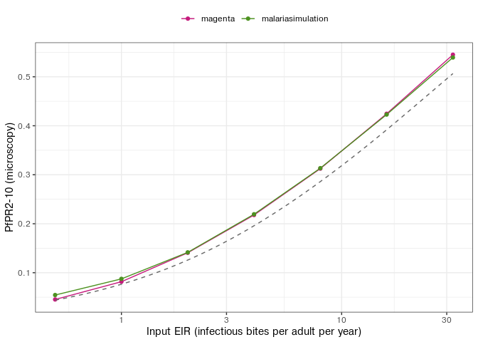
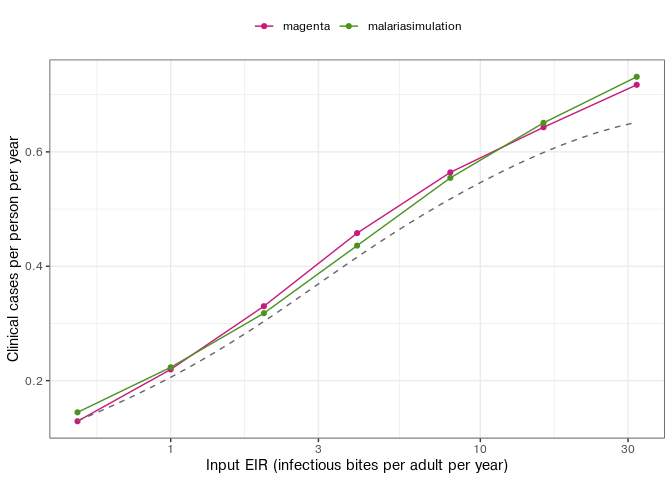
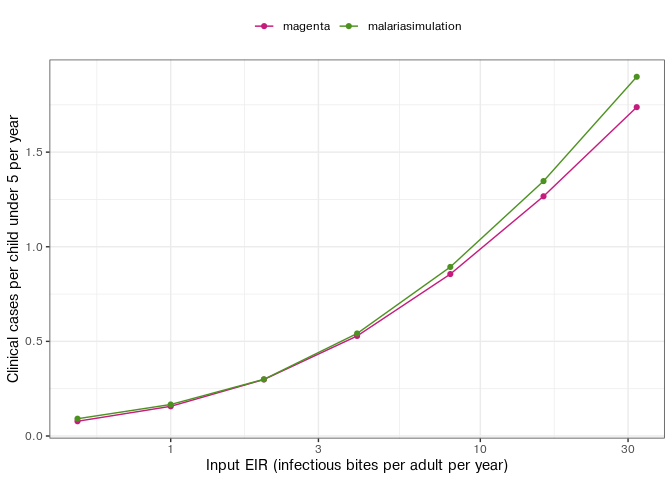
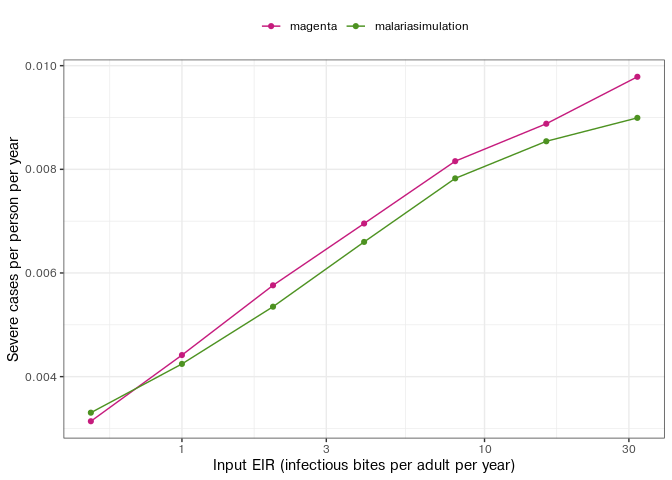
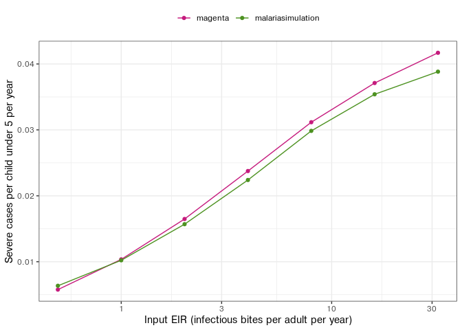
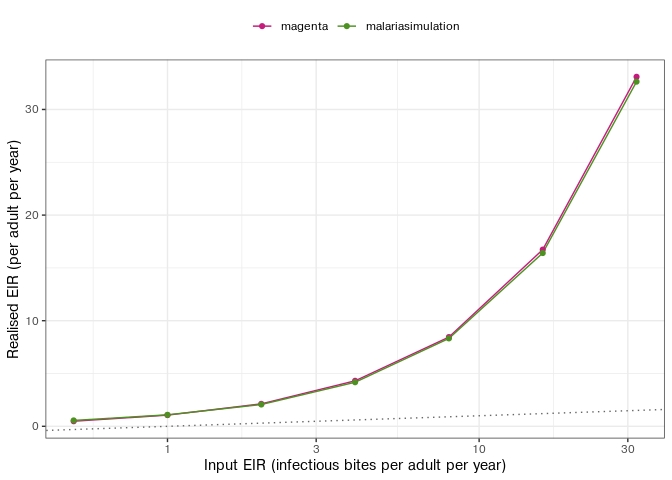

## Overview

`magenta` and [malariasimulation](https://github.com/mrc-ide/malariasimulation)
are both individual-based versions of the Griffin et al. model of *P.
falciparum* transmission, and both start from its deterministic equilibrium.
Given the same EIR they should give the same prevalence, clinical incidence and
severe incidence. This vignette checks that across a range of transmission
intensities, and is the place to rerun the comparison after changes to the
transmission or immunity code.

The two models are run in matched perennial settings:

* the same input EIR, with no seasonality and no vector control,
* 40% of clinical cases treated (`ft = 0.4`), with a drug that always clears
  infection, as `magenta` has no drug failure unless resistance is modelled,
* 50,000 people for 4 years from equilibrium, so incidence is averaged over 4
  years and PfPR2-10 is taken at the end.

The deterministic equilibrium that both models start from is shown as a
reference.


``` r
library(magenta)
library(malariasimulation)
library(ggplot2)

N <- 5e4
YEARS <- 4
FT <- 0.4
EIRS <- c(0.5, 1, 2, 4, 8, 16, 32)
CORES <- 8

# ages in days, magenta's under 5 logger is age <= 5 * 365
age_max <- 100 * 365
age_05 <- 5 * 365
```

## Running the models

### magenta

PfPR2-10 by microscopy counts everyone in D or T, and people in A with their own
probability of detection, as in malariasimulation's `p_detect_lm` output.
Severe incidence is the expected number of severe cases (the `Severe` loggers),
so it carries less noise than counting draws.


``` r
run_magenta <- function(eir, seed) {

  out <- pipeline(EIR = eir, N = N, years = YEARS, ft = FT, num_loci = 2,
                  seed = seed,
                  housekeeping_list = magenta:::housekeeping_list_create(
                    quiet = TRUE, quiet_test = TRUE, cluster = TRUE))
  lg <- out$Loggers
  rates <- severe_rates(lg)

  mpl <- model_param_list_create()
  two_ten <- lg$Ages < 3650 & lg$Ages > 720
  q <- magenta:::q_fun(mpl$d1, lg$ID, mpl$ID0, mpl$kD,
                       sapply(lg$Ages, magenta:::fd, mpl$fD0, mpl$aD, mpl$gammaD))
  pfpr <- (sum(lg$InfectionStates %in% c(1, 4) & two_ten) +
             sum(q[lg$InfectionStates == 2 & two_ten])) / sum(two_ten)

  data.frame(model = "magenta", EIR = eir, pfpr_2_10 = pfpr,
             clinical_all = rates$clinical[1], clinical_05 = rates$clinical[2],
             severe_all = rates$severe[1], severe_05 = rates$severe[2],
             realised_eir = lg$Treatments$daily_infectious_bite_counters / N / YEARS /
               mean(1 - mpl$rho * exp(-lg$Ages / mpl$a0)))
}
```

### malariasimulation

malariasimulation 3.0.0 is used, as released.


``` r
run_malsim <- function(eir, seed) {

  set.seed(seed)

  p <- get_parameters(list(
    human_population = N,
    prevalence_rendering_min_ages = 2 * 365,
    prevalence_rendering_max_ages = 10 * 365 - 1,
    clinical_incidence_rendering_min_ages = c(0, 0),
    clinical_incidence_rendering_max_ages = c(age_05, age_max),
    severe_incidence_rendering_min_ages = c(0, 0),
    severe_incidence_rendering_max_ages = c(age_05, age_max)
  ))
  # a drug that always clears infection
  al <- AL_params
  al[1] <- 1
  p <- set_drugs(p, list(al))
  p <- set_clinical_treatment(p, 1, 1, FT)
  p <- set_equilibrium(p, eir)

  o <- run_simulation(YEARS * 365, p)
  s <- function(x) sum(o[[x]])
  a05 <- paste0("_0_", age_05)
  aall <- paste0("_0_", age_max)

  data.frame(model = "malariasimulation",
             EIR = eir,
             pfpr_2_10 = s("n_detect_lm_730_3649") / s("n_age_730_3649"),
             clinical_all = 365 * s(paste0("p_inc_clinical", aall)) / s(paste0("n_age", aall)),
             clinical_05 = 365 * s(paste0("p_inc_clinical", a05)) / s(paste0("n_age", a05)),
             severe_all = 365 * s(paste0("p_inc_severe", aall)) / s(paste0("n_age", aall)),
             severe_05 = 365 * s(paste0("p_inc_severe", a05)) / s(paste0("n_age", a05)),
             realised_eir = 365 * mean(o$EIR_gamb) / N)
}
```

### Deterministic equilibrium

The equilibrium PfPR2-10 and all-age clinical incidence, from the same
equilibrium solution `magenta` is initialised from. The age groups are chosen
so that 2 and 10 years are group boundaries.


``` r
equilibrium_outputs <- function(eir) {
  eq <- equilibrium_init_create(
    age_vector = c(seq(0, 2, 0.25), 3:10, seq(12.5, 20, 2.5), seq(25, 100, 5)),
    het_brackets = 5, EIR = eir, ft = FT,
    model_param_list = model_param_list_create(),
    country = NULL, admin = NULL, quiet = TRUE)
  by_age <- function(x) rowSums(x[, , 1])
  two_ten <- eq$age >= 730 - 1 & eq$age < 3650 - 1
  detected <- by_age(eq$init_D) + by_age(eq$init_T) + rowSums(eq$init_A[, , 1] * eq$p_det_eq)
  data.frame(EIR = eir,
             pfpr_2_10 = sum(detected[two_ten]) / sum(eq$den[two_ten]),
             clinical_all = 365 * sum(eq$phi_eq * eq$FOI *
                                        (eq$init_S + eq$init_A + eq$init_U)[, , 1]))
}

eq <- do.call(rbind, lapply(exp(seq(log(min(EIRS)), log(max(EIRS)), length.out = 30)),
                            equilibrium_outputs))
```

### Runs


``` r
jobs <- expand.grid(model = c("magenta", "malariasimulation"),
                    eir = EIRS, stringsAsFactors = FALSE)

res <- parallel::mclapply(seq_len(nrow(jobs)), function(i) {
  j <- jobs[i, ]
  switch(j$model,
         magenta = run_magenta(j$eir, seed = 100L + i),
         malariasimulation = run_malsim(j$eir, seed = 100L + i))
}, mc.cores = CORES, mc.preschedule = FALSE)
stopifnot(!vapply(res, inherits, logical(1), "try-error"))
res <- do.call(rbind, res)
```

## Results


``` r
model_colours <- c("magenta" = "#c51b7d", "malariasimulation" = "#4d9221")

plot_outcome <- function(y, ylab, reference = TRUE) {
  g <- ggplot(res, aes(EIR, .data[[y]], colour = model)) +
    geom_line() +
    geom_point() +
    scale_x_log10() +
    scale_colour_manual(values = model_colours) +
    labs(x = "Input EIR (infectious bites per adult per year)", y = ylab,
         colour = NULL) +
    theme_bw() +
    theme(legend.position = "top")
  if (reference && y %in% names(eq)) {
    g <- g + geom_line(data = eq, aes(EIR, .data[[y]]), inherit.aes = FALSE,
                       colour = "grey40", linetype = "dashed")
  }
  g
}
```

The dashed line in each plot is the deterministic equilibrium.

### Prevalence


``` r
plot_outcome("pfpr_2_10", "PfPR2-10 (microscopy)")
```

<!-- -->

### Clinical incidence


``` r
plot_outcome("clinical_all", "Clinical cases per person per year")
```

<!-- -->

``` r
plot_outcome("clinical_05", "Clinical cases per child under 5 per year")
```

<!-- -->

### Severe incidence


``` r
plot_outcome("severe_all", "Severe cases per person per year")
```

<!-- -->

``` r
plot_outcome("severe_05", "Severe cases per child under 5 per year")
```

<!-- -->

### Realised EIR

The infectious bites received over the run, per year, on the same scale as the
input EIR. The input EIR is for an adult and children are bitten less, so
`magenta`'s bites per person are divided by the mean relative biting rate by
age. malariasimulation's `EIR_gamb` output, per person, is already on this
scale. The dotted line is the input EIR.


``` r
plot_outcome("realised_eir", "Realised EIR (per adult per year)",
             reference = FALSE) +
  geom_abline(slope = 1, intercept = 0, colour = "grey40", linetype = "dotted")
```

<!-- -->

### Table

The same results, with hospitalisations and deaths per 1000 people per year
from the severe incidence, using the postie assumptions in `severe_outcomes()`.


``` r
so <- severe_outcomes(res$severe_all, ft = FT)
res$hosp_per_1000 <- 1000 * so$severe_hospital
res$deaths_per_1000 <- 1000 * so$mortality
res <- res[order(res$EIR, res$model), ]
knitr::kable(res, digits = 3, row.names = FALSE)
```


|model             |  EIR| pfpr_2_10| clinical_all| clinical_05| severe_all| severe_05| realised_eir| hosp_per_1000| deaths_per_1000|
|:-----------------|----:|---------:|------------:|-----------:|----------:|---------:|------------:|-------------:|---------------:|
|magenta           |  0.5|     0.045|        0.129|       0.078|      0.003|     0.006|        0.481|         2.726|           0.586|
|malariasimulation |  0.5|     0.054|        0.145|       0.091|      0.003|     0.006|        0.559|         2.870|           0.617|
|magenta           |  1.0|     0.082|        0.220|       0.157|      0.004|     0.010|        1.063|         3.835|           0.825|
|malariasimulation |  1.0|     0.087|        0.223|       0.167|      0.004|     0.010|        1.088|         3.687|           0.793|
|magenta           |  2.0|     0.141|        0.330|       0.299|      0.006|     0.016|        2.128|         5.004|           1.076|
|malariasimulation |  2.0|     0.142|        0.318|       0.300|      0.005|     0.016|        2.066|         4.646|           0.999|
|magenta           |  4.0|     0.218|        0.458|       0.529|      0.007|     0.024|        4.310|         6.040|           1.299|
|malariasimulation |  4.0|     0.219|        0.436|       0.542|      0.007|     0.022|        4.174|         5.731|           1.232|
|magenta           |  8.0|     0.313|        0.564|       0.856|      0.008|     0.031|        8.451|         7.084|           1.523|
|malariasimulation |  8.0|     0.313|        0.555|       0.893|      0.008|     0.030|        8.325|         6.796|           1.461|
|magenta           | 16.0|     0.424|        0.643|       1.267|      0.009|     0.037|       16.731|         7.712|           1.658|
|malariasimulation | 16.0|     0.423|        0.651|       1.347|      0.009|     0.035|       16.407|         7.418|           1.595|
|magenta           | 32.0|     0.545|        0.717|       1.738|      0.010|     0.042|       33.093|         8.498|           1.827|
|malariasimulation | 32.0|     0.539|        0.731|       1.898|      0.009|     0.039|       32.632|         7.810|           1.679|


