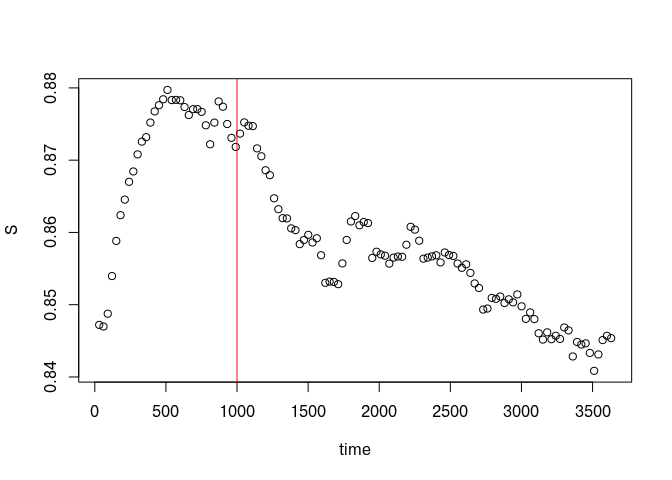
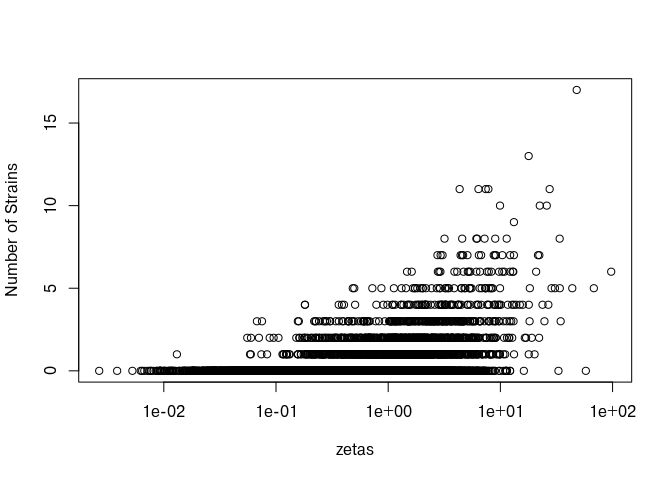
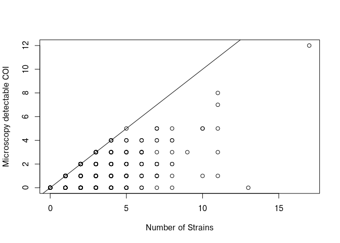
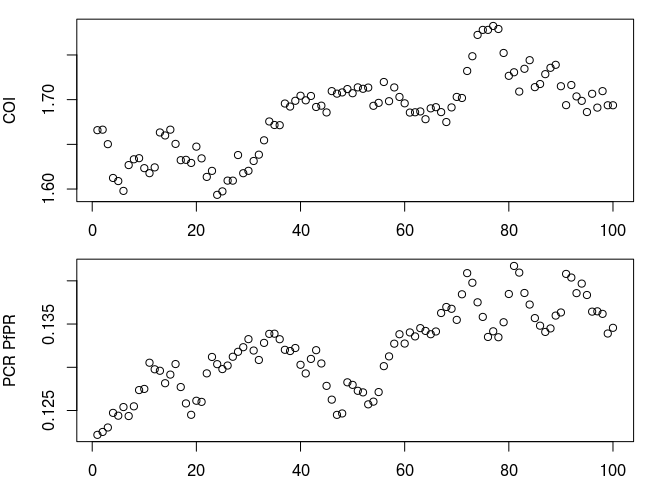
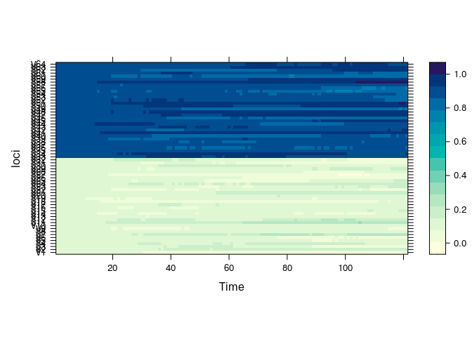
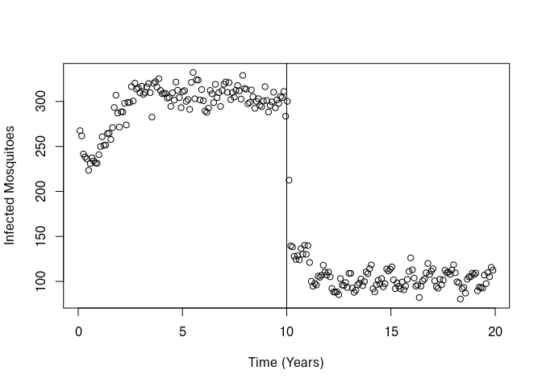
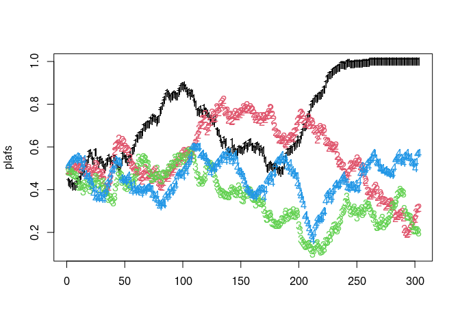
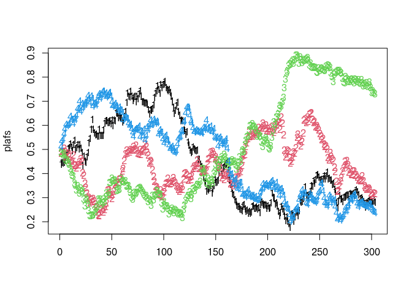
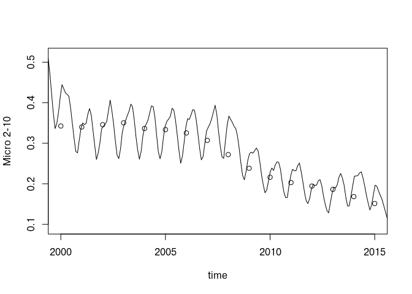

## Overview

`**magenta**` is an individual-based simulation model of malaria epidemiology and parasite genetics. 

`magenta` extends the Imperial malaria model by tracking the infection history of individuals. With this additional genetic characteristics of the parasite can be assessed for looking at both neutral genetic variation as well as loci under selection. 

The model is written in C++/Rcpp and interfaced with R.  

---

## Installation

`magenta` is installed from github with:


``` r
#install.packages("devtools")
devtools::install_github("OJWatson/magenta")
```


``` r
# Load the package
library(magenta)
```

## Demonstration 

### Base Model

The `magenta` simulation model is run using the `pipeline` function, which handles creating needed parameter objects, starting the simulation, summarising the simulation model state at desired intervals and handling how to save the final model output and state. 

For example to run the model for 10 years at an EIR of 1 and no seasonality for a population of 10,000. 


``` r
out1 <- pipeline(EIR = 1, years = 10, N = 10000)
## Seed set to 64577481
## magenta v1.3.7
```

By default, magenta will run the simulation for the entire duration and return a few summaries of the human population at the end of the 10 years, which are stored within the `Loggers` list in `out`. For example, the human proportions in each infection state are the last 6 elements in `Loggers`. 


``` r
as.data.frame(tail(out1$Loggers, 6))
##           S           D          A          U            T           P
## 1 0.8638804 0.001478986 0.09133666 0.03766203 0.0009935616 0.004648384
```

(See the [model output vignette](Loggers.html) for more info about what is returned in Loggers.) 

If we want to save information about the model state over time we set `update_save` to `TRUE` and then specify at what intervals we want to stop the simulation using `update_length`. For example, to fetch information about the simualtion at monthly intervals:


``` r
out2 <- pipeline(EIR = 1, years = 10, N = 10000, 
                 update_save = TRUE, update_length = 30,
                 seed = 123456789L)
## Seed set to 123456789
## magenta v1.3.7
## Starting Stochastic Simulation for 10 years
```

When doing `update_save` we now get a progress bar for the simulation and the returned object `out` is now a list where each the first n-1 elements are unnamed lists and are the saved information at each month. (The last element contains the pointer to the simulation, which allows us to carry on the simulation if needed.) For example to plot the size of the susceptible proportion over time:


``` r
S <- unlist(lapply(out2[1:(length(out2) - 1)], "[[", "S"))
time <- unlist(lapply(out2[1:(length(out2) - 1)], "[[", "Time"))
plot(time, S)
abline(v = 1000, col = "red")
```

<!-- -->

`magenta` starts simulations close to the equilibrium solution, but it is not quite perfect. For example, in the above plot there is a burn in period before the red vertical line. The required burn in time varies depending on the simulation parameters and so it is best to run the model a few times first to work out a suitable burn in time. For most simulations though a 40 year burn in period is more than sufficient. 

In the last simulation run, the random seed was provided, which is used to allow simulations to be able to be run reproducibly. To assist this, the function call and package version are stored with each simulation run as an attribute `meta`. 


``` r
meta <- attr(out2, "meta")
print(meta$call)
## pipeline(EIR = 1, N = 10000, years = 10, update_length = 30, 
##     update_save = TRUE, seed = 123456789L)
print(meta$version)
## [1] '1.3.7'
```

`magenta` primarily characterises parasite populations in terms of a genetic barcode, in which the barcode is a vector of bits representing whether the parasite possesses the major or minor allele at the loci of interest. By default the barcode used is 24 bases long. To see what this looks like, we can request for magenta to return the human population rather than the `Loggers` as the last list element.


``` r
out3 <- pipeline(EIR = 1, years = 10, N = 10000, 
                 update_save = TRUE, update_length = 30, 
                 human_only_full_save = TRUE, 
                 seed = 123456789L)
## Seed set to 123456789
## magenta v1.3.7
## Starting Stochastic Simulation for 10 years
```

We can now look at what is returned in the last list element. 


``` r
names(out3[[length(out3)]])
## [1] "Infection_States"                            
## [2] "Zetas"                                       
## [3] "Ages"                                        
## [4] "ID"                                          
## [5] "Strain_infection_state_vectors"              
## [6] "Strain_day_of_infection_state_change_vectors"
## [7] "Strain_barcode_vectors"
```

Again we return the infection states of the humans, but also their individual biting rates, `Zetas`, detection immunity and their ages, as well as the parasite strain information: 


``` r
# last element
n <- length(out3)

# first individual who is infected, i.e. not in states S or P (order goes S, D, A, U, T, P) 
i <- which.min(out3[[n]]$Infection_States %in% c(0, 5))
out3[[n]]$Strain_barcode_vectors[i]
## [[1]]
## [[1]][[1]]
##  [1]  TRUE  TRUE FALSE FALSE FALSE FALSE FALSE FALSE  TRUE  TRUE FALSE  TRUE
## [13] FALSE FALSE FALSE FALSE  TRUE FALSE FALSE FALSE  TRUE FALSE  TRUE FALSE
```

Above we have found the first individual who is infected and returned the barcodes for each parasite strain the individual has. For example, this individual had one parasite strain, as only one parasite barcode is returned. We can then look at the distribution of parasite strains in the population, for example, against their individual biting rate. 


``` r
zetas <- out3[[n]]$Zetas
n_strains <- unlist(lapply(out3[[n]]$Strain_infection_state_vectors,length))
plot(zetas, n_strains, log = "x", ylab = "Number of Strains")
```

<!-- -->

With the parasite barcode information we can work out what an individual's complexity of infection (COI) is, by looking at the number of unique parasite barcodes within an individual. For example, for the individual with the most amoutn of strains:


``` r

m <- which.max(n_strains)
message("Individual ", m, " has ", n_strains[m], " strains")
## Individual 9109 has 17 strains
un <- length(unique(out3[[n]]$Strain_barcode_vectors[[m]]))
message("Individual ", m, " has ", un, " unique strains")
## Individual 9109 has 16 unique strains
```
The reason we also return the age and the detection immunity, `ID`, is that these are useful for when we want to estimate the COI in terms of what strains are likely to be observed based on their parasitaemia, which is inferred by their detection immunity, `ID`. These can be estimated using `convert_barcode_vectors` as follows, which below is used to show the COI of parsaites that have sufficiently high parasite density to be detected by microscopy if that was the only parasite strain in the infection. 


``` r
cois <- convert_barcode_vectors(out3[[n]], 
                                out3[[n]]$ID, 
                                sub_patents_included = FALSE, 
                                COI_type = "patent")

plot(n_strains, cois$COI, ylab = "Microscopy detectable COI", 
     xlab = "Number of Strains")
abline(0, 1)
```

<!-- -->

We can also request magenta to return all the information about the human and mosquito population:


``` r
out4 <- pipeline(EIR = 1, years = 10, N = 10000, 
                 update_save = TRUE, update_length = 30, 
                 full_save = TRUE, 
                 seed = 123456789L)
## Seed set to 123456789
## magenta v1.3.7
## Starting Stochastic Simulation for 10 years
names(out4[[n]])
## [1] "population_List"                    "populations_event_and_strains_List"
## [3] "scourge_List"                       "parameters_List"                   
## [5] "parameter_housekeeping_List"        "saved_inputs"
```
The last list element now contains 4 lists:

1. `population_List` - Human population demographic information
2. `populations_event_and_strains_List` - Human population's event triggers (e.g. time of next infection event, time of moving state etc) and parasite strains
3. `scourge_List` - The mosquito population and their parasite strains and event triggers. (a scourge is the collective noun for mosquitoes)
4. `parameters_List` - List of simulation parameters

The above 4 lists are sufficient for restarting a simulation and can thus be used to save the model state to file and then be reloaded. See the [model output vignette](Loggers.html) for what these lists contain, and for how to save them to file and reload them to continue a run. 

### Saving different model summaries

`magenta` was initially designed for simulating neutral variation and looking at patterns in COI and parasite diversity. As a result, there are a number of options for saving summaries of the within-host parasite genetic diversity at each update length. 

Previously, we were only saving the human population's parasites in the n-1 element. We can instead save the human population's parasites at each update with `human_update_save`: 


``` r
out5 <- pipeline(EIR = 1, years = 10, N = 10000, 
                 update_save = TRUE, update_length = 30, 
                 human_update_save = TRUE, 
                 summary_saves_only = FALSE,
                 full_save = TRUE, 
                 seed = 123456789L)
## Seed set to 123456789
## magenta v1.3.7
## Starting Stochastic Simulation for 10 years
```

From this we could then calculate the population COI at each monthly interval amongst other genetic traits. However, saving all this information to file quickly takes up a lot of memory. Instead, we can request for the information to be summarised using `summary_saves_only`:


``` r
out6 <- pipeline(EIR = 1, years = 10, N = 10000, 
                 update_save = TRUE, update_length = 30, 
                 human_update_save = TRUE, 
                 summary_saves_only = TRUE,
                 full_save = TRUE, 
                 seed = 123456789L)
## Seed set to 123456789
## magenta v1.3.7
## Starting Stochastic Simulation for 10 years
```

When saving summaries of the genetic information, the mean COI, % polygenomic infections, % unique barcodes and coefficient of uniqueness (see manuscript for definition) are recorded for seperate age and infection status groups. In addition, the overall clonality is recorded (how many of each barcode were there) and the population level allele frequency are saved. Lastly, some extra summaries of the population are saved, which include treatments given in the preceeding month, EIR and prevalence. For full explanation see the [model output vignette](Loggers.html). For example, for COI the following data is stored:


``` r
out6[[1]]$summary_coi
##       age_bin     clinical    N     mean
## 1  (-0.001,5] Asymptomatic  140 3.807143
## 2  (-0.001,5]     Clinical    3 1.000000
## 3  (-0.001,5]            P    3 0.000000
## 4  (-0.001,5]            S 2084 0.000000
## 5      (5,15] Asymptomatic  416 2.951923
## 6      (5,15]     Clinical    7 1.000000
## 7      (5,15]            P   18 0.000000
## 8      (5,15]            S 2467 0.000000
## 9    (15,100] Asymptomatic  893 2.883539
## 10   (15,100]     Clinical   11 1.272727
## 11   (15,100]            P   23 0.000000
## 12   (15,100]            S 3935 0.000000
```

We can then plot the population mean COI over time as follows, using the last 100 values after an approximate burnin period:


``` r

# We don't want the last element as the last save
pos <- 1:(length(out6) - 1)
COI <- unlist(lapply(out6[pos], function(x) { 
    inf <- x$summary_coi$clinical %in% c("Asymptomatic","Clinical")
    weighted.mean(x$summary_coi$mean[inf], x$summary_coi$N[inf]) 
}))
prev <- unlist(lapply(out6[pos], function(x) {x$pcr_prev}))

par(mfrow=c(2,1), mar=c(2,4,1,2))
plot(tail(COI,100), xlab = "", ylab = "COI")
plot(tail(prev,100), xlab = "", ylab = "PCR PfPR")
```

<!-- -->

We can increase the length of the barcode or change the assumed population level allele frequencey as well:


``` r
out7 <- pipeline(EIR = 1, years = 10, N = 10000, 
                 num_loci = 64, 
                 plaf = c(rep(0.1, 32), rep(0.9, 32)),
                 update_save = TRUE, 
                 update_length = 30, 
                 human_update_save = TRUE, 
                 summary_saves_only = TRUE,
                 full_save = TRUE, 
                 seed = 123456789L)
## Seed set to 123456789
## magenta v1.3.7
## Starting Stochastic Simulation for 10 years
```

And we can look at these over time:


``` r
plafs <- do.call(rbind,lapply(out7[pos], function(x) {x$barcode_freq}))
lattice::levelplot(plafs, xlab = "Time", ylab = "loci")
```

<!-- -->

We can also change how we summarise the simulation at each interval. This can be done in a couple of ways. The first is by altering the age and states:


``` r
out8 <- pipeline(EIR = 1, years = 10, N = 10000, 
                 age_breaks = c(-0.1,5,10,15,20,100), 
                 sample_states = c(1:4),
                 update_save = TRUE, 
                 update_length = 30, 
                 human_update_save = TRUE, 
                 summary_saves_only = TRUE,
                 full_save = TRUE, 
                 seed = 123456789L)
## Seed set to 123456789
## magenta v1.3.7
## Starting Stochastic Simulation for 10 years

out8[[1]]$summary_coi
##      age_bin     clinical   N     mean
## 1 (-0.001,5] Asymptomatic 140 3.807143
## 2 (-0.001,5]     Clinical   3 1.000000
## 3     (5,15] Asymptomatic 416 2.951923
## 4     (5,15]     Clinical   7 1.000000
## 5   (15,100] Asymptomatic 893 2.883539
## 6   (15,100]     Clinical  11 1.272727
```

The next is by providing your own update function as `update_save_func`. Have a look at the code for `update_saves` to see the style required. 

### Interventions

`magenta` also allows you to specify interventions in the form of the altering the use of insecticide treated nets (`itn_cov`), indoor residual spraying (`irs_cov`) and changing the frequency of treatment (`ft`). These should be provided as vector that dictate the annual coverage. 


``` r
out9 <- pipeline(EIR = 4, years = 20, N = 10000,
                 ft = c(rep(0,10), rep(0.2,10)),
                 irs_cov = c(rep(0,10), rep(0.2,10)),
                 itn_cov = c(rep(0,10), rep(0.2,10)),
                 update_save = TRUE, 
                 update_length = 30, 
                 seed = 123456789L)
## Seed set to 123456789
## magenta v1.3.7
## 
## Running Deterministic Model for 20 years
## Starting Stochastic Simulation for 20 years

infected_mosquitoes <- unlist(lapply(out9, function(x) {x$Mosquitoes$Mos_I}))
time <- unlist(lapply(out9, function(x) {x$Time}))/365
plot(time, infected_mosquitoes, xlab = "Time (Years)", ylab = "Infected Mosquitoes")
abline(v = 10)
```

<!-- -->

`magenta` incorporates vector based interventions by first running an equivalent deterministic version of the malaria transmission model with vector based intervetnions in. The output of the determininistic model is used to estimate the changing mosquito mortality rate and anthrophagy at each day as a result of the intervention changes. These are then fed through to the indivdual-based simulation to adjust the behaviour of the individual mosquitoes. 

### Space 

`magenta` can currently be run under 2 different spatial models. The first is a closed population, with no importation. In this scenario, there will eventually be one parsaite genetic barcode that becomes fixed. To demonstrate this, we can simulate a smaller population of 1000 indiivduals, with only 4 loci in the barcode, for 25 years. The `spatial_type` is set to `NULL` here, which assumes a closed population and is also the default space option.  


``` r
out10 <- pipeline(EIR = 1, 
                 years = 25, N = 1000, 
                 spatial_type = NULL,
                 num_loci = 4, 
                 update_save = TRUE, 
                 update_length = 30, 
                 human_update_save = TRUE, 
                 summary_saves_only = TRUE,
                 full_save = TRUE, 
                 seed = 123456789L)
## Seed set to 123456789
## magenta v1.3.7
## Starting Stochastic Simulation for 25 years
```

We can see this process again by plotting the barcode frequency over time for the fist n-1 elements (as the last list element will not contain the barcode_frequency summary)


``` r
pos <- 1:(length(out10) - 1)
plafs <- do.call(rbind,lapply(out10[pos], function(x) {x$barcode_freq}))
matplot(plafs)
```

<!-- -->

We can change this to have importation of barcodes over time. This occurs with a genetic island model where the population we are simulating is assumed to receive imported parasites from a genetically stable population. There are two forms of importation, the `spatial_incidence_matrix` and `spatial_mosquitoFOI_matrix`, which determine the rate at which new parasites are imported into the human and mosquito population respectively. In the following we assume that 20% of new infections in both the humans and mosquito populations are actually imported, with the barcodes drawn according to the population level allele frequency (PLAF) (by default the PLAF is 0.5 for each loci). This ensures that a genetic equilibrium is reached and barcode fixation does not occur.


``` r
out11 <- pipeline(EIR = 1, 
                 years = 25, 
                 N = 1000, 
                 spatial_type = "island",
                 spatial_incidence_matrix = 0.2,
                 spatial_mosquitoFOI_matrix = 0.2,
                 num_loci = 4, 
                 update_save = TRUE, 
                 update_length = 30, 
                 human_update_save = TRUE, 
                 summary_saves_only = TRUE,
                 full_save = TRUE, 
                 seed = 123456789L)
## Seed set to 123456789
## magenta v1.3.7
## Starting Stochastic Simulation for 25 years

pos <- 1:(length(out11) - 1)
plafs <- do.call(rbind,lapply(out11[pos], function(x) {x$barcode_freq}))
matplot(plafs)
```

<!-- -->

### Seasonality and Specific Locations

Included in `magenta` are the historic interventions and seasonality profiles for admin level one regions in sub-Saharan African countries. These can then be used to draw up the required parameter sets for a given region. E.g. to simulate for Kinsasha from 1980:2015


``` r

# set up the years
year_range <- 1980:2015

# grab the interventions for region of interest
country <- "Democratic Republic of the Congo"
admin <- "Kinshasa"
ints <- intervention_grab(country = country, 
                          admin = admin,
                          year_range = year_range)
## Requested: Kinshasa, Democratic Republic of the Congo
## Returned: Kinshasa, Democratic Republic of the Congo

# grab the importation from the migration model
spl <- spl_grab(country, admin, year_range)
## Requested: Kinshasa, Democratic Republic of the Congo
## Returned: Kinshasa_City, Democratic Republic of the Congo

# get the intervention parmeters
ft <- ints$ft
itn_cov <- ints$itn_cov
irs_cov <- ints$irs_cov

# load the Malaria Atlas Project Prevalence data
MAP_file <- system.file("extdata/MAP_PfPR_population_weighted.csv", 
                        package = "magenta")
MAP <- read.csv(MAP_file)

# work out the EIR for the prevalence in year 2000 (i.e. pre interventions)
pfpr_micro <- MAP$X2000[which(MAP$Name==admin)]
EIR <- magenta:::pfpr_to_eir_heuristic(ft = 0, PfPR_micro = pfpr_micro)
## 0.00152858753907675

# run the simulation
out12 <- pipeline(
  EIR = EIR,
  N = 10000,
  years = length(itn_cov),
  country = country,
  admin = admin,
  itn_cov = itn_cov,
  irs_cov = irs_cov,
  ft = ft,
  spatial_incidence_matrix = spl$incidence,
  spatial_mosquitoFOI_matrix = spl$mosquitoFOI,
  spatial_type = "island",
  human_only_full_save = TRUE,
  update_length = 30,
  update_save = TRUE,
  human_update_save = FALSE,
  summary_saves_only = FALSE,
)
## Seed set to 693175740
## magenta v1.3.7
## Requested: Kinshasa, Democratic Republic of the Congo
## Returned: Kinshasa, Democratic Republic of the Congo
## Requested: Kinshasa, Democratic Republic of the Congo
## Returned: Kinshasa, Democratic Republic of the Congo
## 
## Running Deterministic Model for 36 years
## Starting Stochastic Simulation for 36 years

# Grab the microscopy prevalence over time in 2-10s
pos <- 1:(length(out12)-1)
time <- 1980 + unlist(lapply(out12[pos], "[[", "Time"))/365
prev_2_10_micro <- unlist(lapply(out12[pos], function(x) { 
  magenta:::microscopy_detected(ages = x$Ages, 
                                IDs = x$ID, 
                                states = x$InfectionStates)
  }))

# get the MAP estimates
map_prev <- MAP[which(MAP$Name==admin),5:20]

# plot the relationship
plot(time, prev_2_10_micro, xlim = c(2000,2015), 
     ylab = "Micro 2-10", type = "l")
points(2000:2015, map_prev)
```

<!-- -->

The above is similar to how the model fitting simulations were laid out and it gives the user a chance to check that the parameter sets being used are the correct parameters. However, you can use `use_historic_interventions` as `TRUE` and provide the year range and `pipeline` will conduct the above parameter searching for you.

As an aside, `magenta` has a multitude of little helped functions like `microscopy_detected` that are not exported currently, due to their use in mainly assisting downstream analysis rather than being for simulation directly. 

### IBD Simulations

`magenta` was also designed to simulate patterns in identity-by-descent (IBD). In these simulations, the barcode is adapted such that each loci is represented by multiple bits that represent a unique integer rather than a single bit. The integers are assigned at the beginning of the simulation, with consecutive integers assigned to each parasite, which allows the pedigree of parasites to be tracked. These simulations are slower as the bitset container used to represnt is substantially larger and simulating recombination and new variants is slightly more involved. In addition, summarising the parasite population at monthly intervals takes more time and more memory is required to simulate patterns of IBD.

To simulate IBD, we allocate the `ibd_length`, which is the bumber of bits used to represent one locus. The number of bits used gives the maximum number of parasite pedigrees that can be tracked, which is equal to `2^ibd_length`. As a result you need to double check that you will not exceed this number during a simulation. An easy way to check is to use the argument `set_up_only`, which will return the simulation model state after it has been initialised: 


``` r
out13 <- pipeline(EIR = 1, 
                  years = 10, 
                  N = 1000,  
                  ibd_length = 20, 
                  num_loci = 24,
                  set_up_only = TRUE,
                  update_save = TRUE, 
                  update_length = 30, 
                  human_update_save = TRUE, 
                  summary_saves_only = TRUE,
                  full_save = TRUE, 
                  seed = 123456789L)
## Seed set to 123456789
## magenta v1.3.7
## Set Up Grab

names(out13)

## [1] "population_List"                    "populations_event_and_strains_List"
## [3] "scourge_List"                       "parameters_List"                   
## [5] "parameter_housekeeping_List"        "saved_inputs"
```

From this we can have a look at the strains to see the IBD representation used:


``` r

infected <- which(out13$population_List$Infection_States %in% c(1:4))
strains <- out13$populations_event_and_strains_List$Strain_barcode_vectors[infected]

strains[1]
## [[1]]
## [[1]][[1]]
##   [1] FALSE FALSE FALSE FALSE FALSE FALSE FALSE FALSE FALSE FALSE FALSE FALSE
##  [13] FALSE FALSE FALSE FALSE FALSE FALSE FALSE FALSE FALSE FALSE FALSE FALSE
##  [25] FALSE FALSE FALSE FALSE FALSE FALSE FALSE FALSE FALSE FALSE FALSE FALSE
##  [37] FALSE FALSE FALSE FALSE FALSE FALSE FALSE FALSE FALSE FALSE FALSE FALSE
##  [49] FALSE FALSE FALSE FALSE FALSE FALSE FALSE FALSE FALSE FALSE FALSE FALSE
##  [61] FALSE FALSE FALSE FALSE FALSE FALSE FALSE FALSE FALSE FALSE FALSE FALSE
##  [73] FALSE FALSE FALSE FALSE FALSE FALSE FALSE FALSE FALSE FALSE FALSE FALSE
##  [85] FALSE FALSE FALSE FALSE FALSE FALSE FALSE FALSE FALSE FALSE FALSE FALSE
##  [97] FALSE FALSE FALSE FALSE FALSE FALSE FALSE FALSE FALSE FALSE FALSE FALSE
## [109] FALSE FALSE FALSE FALSE FALSE FALSE FALSE FALSE FALSE FALSE FALSE FALSE
## [121] FALSE FALSE FALSE FALSE FALSE FALSE FALSE FALSE FALSE FALSE FALSE FALSE
## [133] FALSE FALSE FALSE FALSE FALSE FALSE FALSE FALSE FALSE FALSE FALSE FALSE
## [145] FALSE FALSE FALSE FALSE FALSE FALSE FALSE FALSE FALSE FALSE FALSE FALSE
## [157] FALSE FALSE FALSE FALSE FALSE FALSE FALSE FALSE FALSE FALSE FALSE FALSE
## [169] FALSE FALSE FALSE FALSE FALSE FALSE FALSE FALSE FALSE FALSE FALSE FALSE
## [181] FALSE FALSE FALSE FALSE FALSE FALSE FALSE FALSE FALSE FALSE FALSE FALSE
## [193] FALSE FALSE FALSE FALSE FALSE FALSE FALSE FALSE FALSE FALSE FALSE FALSE
## [205] FALSE FALSE FALSE FALSE FALSE FALSE FALSE FALSE FALSE FALSE FALSE FALSE
## [217] FALSE FALSE FALSE FALSE FALSE FALSE FALSE FALSE FALSE FALSE FALSE FALSE
## [229] FALSE FALSE FALSE FALSE FALSE FALSE FALSE FALSE FALSE FALSE FALSE FALSE
## [241] FALSE FALSE FALSE FALSE FALSE FALSE FALSE FALSE FALSE FALSE FALSE FALSE
## [253] FALSE FALSE FALSE FALSE FALSE FALSE FALSE FALSE FALSE FALSE FALSE FALSE
## [265] FALSE FALSE FALSE FALSE FALSE FALSE FALSE FALSE FALSE FALSE FALSE FALSE
## [277] FALSE FALSE FALSE FALSE FALSE FALSE FALSE FALSE FALSE FALSE FALSE FALSE
## [289] FALSE FALSE FALSE FALSE FALSE FALSE FALSE FALSE FALSE FALSE FALSE FALSE
## [301] FALSE FALSE FALSE FALSE FALSE FALSE FALSE FALSE FALSE FALSE FALSE FALSE
## [313] FALSE FALSE FALSE FALSE FALSE FALSE FALSE FALSE FALSE FALSE FALSE FALSE
## [325] FALSE FALSE FALSE FALSE FALSE FALSE FALSE FALSE FALSE FALSE FALSE FALSE
## [337] FALSE FALSE FALSE FALSE FALSE FALSE FALSE FALSE FALSE FALSE FALSE FALSE
## [349] FALSE FALSE FALSE FALSE FALSE FALSE FALSE FALSE FALSE FALSE FALSE FALSE
## [361] FALSE FALSE FALSE FALSE FALSE FALSE FALSE FALSE FALSE FALSE FALSE FALSE
## [373] FALSE FALSE FALSE FALSE FALSE FALSE FALSE FALSE FALSE FALSE FALSE FALSE
## [385] FALSE FALSE FALSE FALSE FALSE FALSE FALSE FALSE FALSE FALSE FALSE FALSE
## [397] FALSE FALSE FALSE FALSE FALSE FALSE FALSE FALSE FALSE FALSE FALSE FALSE
## [409] FALSE FALSE FALSE FALSE FALSE FALSE FALSE FALSE FALSE FALSE FALSE FALSE
## [421] FALSE FALSE FALSE FALSE FALSE FALSE FALSE FALSE FALSE FALSE FALSE FALSE
## [433] FALSE FALSE FALSE FALSE FALSE FALSE FALSE FALSE FALSE FALSE FALSE FALSE
## [445] FALSE FALSE FALSE FALSE FALSE FALSE FALSE FALSE FALSE FALSE FALSE FALSE
## [457] FALSE FALSE FALSE FALSE FALSE FALSE FALSE FALSE FALSE FALSE FALSE FALSE
## [469] FALSE FALSE FALSE FALSE FALSE FALSE FALSE FALSE FALSE FALSE FALSE FALSE
## 
## [[1]][[2]]
##   [1]  TRUE FALSE FALSE FALSE FALSE FALSE FALSE FALSE FALSE FALSE FALSE FALSE
##  [13] FALSE FALSE FALSE FALSE FALSE FALSE FALSE FALSE  TRUE FALSE FALSE FALSE
##  [25] FALSE FALSE FALSE FALSE FALSE FALSE FALSE FALSE FALSE FALSE FALSE FALSE
##  [37] FALSE FALSE FALSE FALSE  TRUE FALSE FALSE FALSE FALSE FALSE FALSE FALSE
##  [49] FALSE FALSE FALSE FALSE FALSE FALSE FALSE FALSE FALSE FALSE FALSE FALSE
##  [61]  TRUE FALSE FALSE FALSE FALSE FALSE FALSE FALSE FALSE FALSE FALSE FALSE
##  [73] FALSE FALSE FALSE FALSE FALSE FALSE FALSE FALSE  TRUE FALSE FALSE FALSE
##  [85] FALSE FALSE FALSE FALSE FALSE FALSE FALSE FALSE FALSE FALSE FALSE FALSE
##  [97] FALSE FALSE FALSE FALSE  TRUE FALSE FALSE FALSE FALSE FALSE FALSE FALSE
## [109] FALSE FALSE FALSE FALSE FALSE FALSE FALSE FALSE FALSE FALSE FALSE FALSE
## [121]  TRUE FALSE FALSE FALSE FALSE FALSE FALSE FALSE FALSE FALSE FALSE FALSE
## [133] FALSE FALSE FALSE FALSE FALSE FALSE FALSE FALSE  TRUE FALSE FALSE FALSE
## [145] FALSE FALSE FALSE FALSE FALSE FALSE FALSE FALSE FALSE FALSE FALSE FALSE
## [157] FALSE FALSE FALSE FALSE  TRUE FALSE FALSE FALSE FALSE FALSE FALSE FALSE
## [169] FALSE FALSE FALSE FALSE FALSE FALSE FALSE FALSE FALSE FALSE FALSE FALSE
## [181]  TRUE FALSE FALSE FALSE FALSE FALSE FALSE FALSE FALSE FALSE FALSE FALSE
## [193] FALSE FALSE FALSE FALSE FALSE FALSE FALSE FALSE  TRUE FALSE FALSE FALSE
## [205] FALSE FALSE FALSE FALSE FALSE FALSE FALSE FALSE FALSE FALSE FALSE FALSE
## [217] FALSE FALSE FALSE FALSE  TRUE FALSE FALSE FALSE FALSE FALSE FALSE FALSE
## [229] FALSE FALSE FALSE FALSE FALSE FALSE FALSE FALSE FALSE FALSE FALSE FALSE
## [241]  TRUE FALSE FALSE FALSE FALSE FALSE FALSE FALSE FALSE FALSE FALSE FALSE
## [253] FALSE FALSE FALSE FALSE FALSE FALSE FALSE FALSE  TRUE FALSE FALSE FALSE
## [265] FALSE FALSE FALSE FALSE FALSE FALSE FALSE FALSE FALSE FALSE FALSE FALSE
## [277] FALSE FALSE FALSE FALSE  TRUE FALSE FALSE FALSE FALSE FALSE FALSE FALSE
## [289] FALSE FALSE FALSE FALSE FALSE FALSE FALSE FALSE FALSE FALSE FALSE FALSE
## [301]  TRUE FALSE FALSE FALSE FALSE FALSE FALSE FALSE FALSE FALSE FALSE FALSE
## [313] FALSE FALSE FALSE FALSE FALSE FALSE FALSE FALSE  TRUE FALSE FALSE FALSE
## [325] FALSE FALSE FALSE FALSE FALSE FALSE FALSE FALSE FALSE FALSE FALSE FALSE
## [337] FALSE FALSE FALSE FALSE  TRUE FALSE FALSE FALSE FALSE FALSE FALSE FALSE
## [349] FALSE FALSE FALSE FALSE FALSE FALSE FALSE FALSE FALSE FALSE FALSE FALSE
## [361]  TRUE FALSE FALSE FALSE FALSE FALSE FALSE FALSE FALSE FALSE FALSE FALSE
## [373] FALSE FALSE FALSE FALSE FALSE FALSE FALSE FALSE  TRUE FALSE FALSE FALSE
## [385] FALSE FALSE FALSE FALSE FALSE FALSE FALSE FALSE FALSE FALSE FALSE FALSE
## [397] FALSE FALSE FALSE FALSE  TRUE FALSE FALSE FALSE FALSE FALSE FALSE FALSE
## [409] FALSE FALSE FALSE FALSE FALSE FALSE FALSE FALSE FALSE FALSE FALSE FALSE
## [421]  TRUE FALSE FALSE FALSE FALSE FALSE FALSE FALSE FALSE FALSE FALSE FALSE
## [433] FALSE FALSE FALSE FALSE FALSE FALSE FALSE FALSE  TRUE FALSE FALSE FALSE
## [445] FALSE FALSE FALSE FALSE FALSE FALSE FALSE FALSE FALSE FALSE FALSE FALSE
## [457] FALSE FALSE FALSE FALSE  TRUE FALSE FALSE FALSE FALSE FALSE FALSE FALSE
## [469] FALSE FALSE FALSE FALSE FALSE FALSE FALSE FALSE FALSE FALSE FALSE FALSE
```

The first infected individual is infected with two parasites as indicated with the two strain barcode vectors. The first is the binary representation of `rep(0, 24)` and the next is `rep(1,24)`. To convert these to integer vectors we can use the unexported `convert_ibd_barcode` passing in the barcode and the number of loci (`nl`) being simulated. So the first parasite in the second infected individual should be represented by a barcode of 2s give that the first individual had two strains (i.e. the 0s and the 1s).


``` r
magenta:::convert_ibd_barcode(strains[[2]][[1]], nl = 24)
##  [1] 2 2 2 2 2 2 2 2 2 2 2 2 2 2 2 2 2 2 2 2 2 2 2 2
```

We can then work out how many parasites have been allocated in the simulation to begin with:


``` r

last_infected <- tail(strains,1)[[1]]
magenta:::convert_ibd_barcode(last_infected[[length(last_infected)]], nl = 24)
##  [1] 607 607 607 607 607 607 607 607 607 607 607 607 607 607 607 607 607 607 607
## [20] 607 607 607 607 607
```

Clearly `2^20` will be plenty, even if we add in substantial importation, with importation in the IBD model importing the next integer barcode, i.e. `rep(608, 24)`. Just remember you need to factor in both the rate of importation, the length of the simulation and the size of the population. We can do the same check at the end of the simulation to make sure we allocated sufficient bits. 


``` r

out14 <- pipeline(EIR = 1, 
                  years = 10, 
                  N = 1000,  
                  ibd_length = 20, 
                  num_loci = 24,
                  spatial_type = "island",
                  spatial_incidence_matrix = 0.2,
                  spatial_mosquitoFOI_matrix = 0.2,
                  update_save = TRUE, 
                  update_length = 30, 
                  human_update_save = TRUE, 
                  summary_saves_only = TRUE,
                  full_save = TRUE, 
                  seed = 123456789L)
## Seed set to 123456789
## magenta v1.3.7
## Starting Stochastic Simulation for 10 years

l <- length(out14)
strains <- out14[[l]]$populations_event_and_strains_List$Strain_barcode_vectors
infected <- which(out14[[l]]$population_List$Infection_States %in% c(1:4))

converted_barcodes <- lapply(strains[infected], function(x) {
  lapply(x, magenta:::convert_ibd_barcode, 24)
})

max(unlist(converted_barcodes))

## [1] 9026
```

Definitely plenty.

As when simulating normal barcodes, a summary of the genetics is made at each update interval. For simulations of IBD, we save the population level IBD (pIBD in the manuscript) as `summary_ibd` and the within host IBD (iIBD in the manuscript) as `summary_within_ibd`. The same system is used for how to bin the population into clinical infection and age groups:


``` r
out14[[1]]$summary_ibd
##       age_bin     clinical  N         mean
## 1  (-0.001,5] Asymptomatic 14 0.0001123091
## 2  (-0.001,5]     Clinical  1 0.0062893082
## 3  (-0.001,5]            P  0          NaN
## 4  (-0.001,5]            S  0          NaN
## 5      (5,15] Asymptomatic 27 0.0001946059
## 6      (5,15]     Clinical  1 0.0018343816
## 7      (5,15]            S  0          NaN
## 8    (15,100] Asymptomatic 62 0.0002600948
## 9    (15,100]            P  0          NaN
## 10   (15,100]            S  0          NaN
```

And for iIBD:


``` r
out14[[1]]$summary_within_ibd
##       age_bin     clinical  N mean
## 1  (-0.001,5] Asymptomatic  8    0
## 2  (-0.001,5]     Clinical  0  NaN
## 3  (-0.001,5]            P  0  NaN
## 4  (-0.001,5]            S  0  NaN
## 5      (5,15] Asymptomatic 19    0
## 6      (5,15]     Clinical  0  NaN
## 7      (5,15]            S  0  NaN
## 8    (15,100] Asymptomatic 23    0
## 9    (15,100]            P  0  NaN
## 10   (15,100]            S  0  NaN
```

Note how the denominator is different between the two measures. This is because iIBD is the comparison of IBD (same integer at a given locus) of the strains within an individual. Thus if an individual is only infected with one parasite strain then iIBD can not be calculated and these individuals are not included. 

## Summary

The above introduction gives an overview of how to run the model and covers all components of `magenta` that were used to produce the findings in the [BioArxiv manuscript](https://www.biorxiv.org/content/10.1101/793554v1). 

`magenta` has also been developed to simulate antimalarial drug resistance, which is
covered across three further vignettes:

* [Simulating antimalarial resistance](Resistance.html) for resistance loci, drug
  definitions, prophylaxis, mutation, importation and fitness costs.
* [Drug deployment strategies](DrugStrategies.html) for multiple first line therapies,
  drug cycling and non-malarial fevers.
* [Adding a new drug](NewDrugs.html) for defining therapies the package does not ship
  with, worked through with single low-dose primaquine.

The [model output vignette](Loggers.html) describes everything a simulation can return
and how to save and restart runs.

Spatial simulation is partially implemented: the island importation model demonstrated
above is available, while the metapopulation model is not yet complete.
