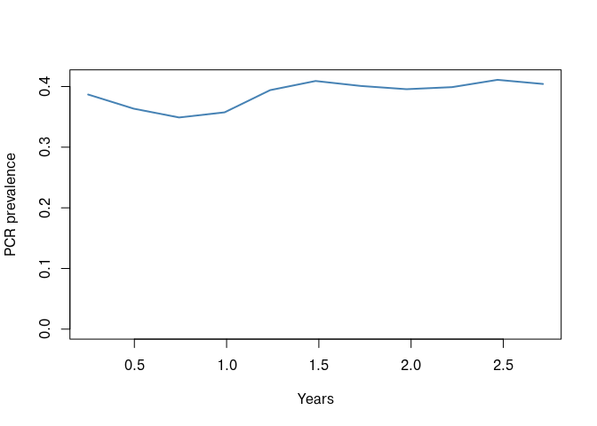

## Overview

A `magenta` simulation holds its entire state in C++ memory. What comes back
into R is whatever you ask `pipeline()` to extract, and the choice matters: a
full population dump at monthly intervals over 40 years is large enough to be
awkward, while the default summary may not contain what you need.

This vignette describes what each saver returns, what the individual loggers
mean, and how to save a simulation to disk and restart it later.

Every run returns a `magenta_sim` with four elements: `output` (what the saver
kept), `params` (the inputs the run was created with), `schedule` (the
per-period table of inputs the run followed) and `meta` (call, seed, version,
timings).


``` r
library(magenta)
```

---

## The default: loggers only

With no saving options, `pipeline()` runs to the end and its `output` is a
single list containing `Loggers`, a snapshot of the population at the final
time step.


``` r
out <- pipeline(EIR = 5, N = 1000, years = 3, ft = 0.4, seed = 1L)
## Seed set to 1
## magenta v1.4.0
out
## <magenta_sim>
##   call:     pipeline(EIR = 5, ft = 0.4, N = 1000, years = 3, seed = 1L)
##   N: 1000   years: 3   EIR: 5
##   output:   loggers, 1 period(s), final = loggers
##   seed:     1   version: 1.4.0
##   elapsed:  0.8 secs
names(out$output$Loggers)
##  [1] "Log_Counter"              "Incidence"               
##  [3] "Incidence_05"             "Treatments"              
##  [5] "daily_mutations_per_loci" "InfectionStates"         
##  [7] "Ages"                     "IB"                      
##  [9] "ICA"                      "ICM"                     
## [11] "ID"                       "Mosquitoes"              
## [13] "Time"                     "S"                       
## [15] "D"                        "A"                       
## [17] "U"                        "T"                       
## [19] "P"
```

The entries fall into four groups.

**Population state.** `S`, `D`, `A`, `U`, `T` and `P` are the proportion of
people in each infection state: susceptible, clinical disease, asymptomatic,
subpatent, treated and prophylactic.


``` r
as.data.frame(out$output$Loggers[c("S", "D", "A", "U", "T", "P")])
##           S           D         A         U           T          P
## 1 0.6158804 0.003590868 0.2853543 0.0826347 0.002294064 0.01024566
```

**Per individual vectors.** `Ages` (in days), `InfectionStates` coded `0:5` in
the order above, and the four immunity functions: `IB` (pre-erythrocytic),
`ICA` (acquired clinical), `ICM` (maternal clinical) and `ID` (detection).
`ID` is the one used to decide whether an infection would be detected by
microscopy, and is needed by `convert_barcode_vectors()`.


``` r
sapply(out$output$Loggers[c("Ages", "InfectionStates", "IB", "ICA", "ICM", "ID")], length)
##            Ages InfectionStates              IB             ICA             ICM 
##            1000            1000            1000            1000            1000 
##              ID 
##            1000
```

**Counters.** `Incidence` and `Incidence_05` are clinical cases over the logging
window, all ages and under fives respectively. `Log_Counter` is the number of
days that window covered, which is what you divide by to turn counts into
rates. `daily_mutations_per_loci` counts mutations at each barcode locus.

**Sub-lists.** `Treatments` records treatment outcomes and biting:


``` r
str(out$output$Loggers$Treatments)
## List of 5
##  $ Successful_Treatments         : num 448
##  $ Unsuccesful_Treatments_LPF    : num 0
##  $ Not_Treated                   : num 690
##  $ daily_bite_counters           : int 972234
##  $ daily_infectious_bite_counters: int 10231
```

`Successful_Treatments` and `Unsuccesful_Treatments_LPF` are counts of
treatments that cured and that ended in a 28 day late parasitological failure.
With more than one drug deployed these become vectors, one entry per drug.
`Not_Treated` counts clinical cases that did not receive treatment.
`daily_bite_counters` and `daily_infectious_bite_counters` accumulate bites over
the logging window, and dividing the latter by `Log_Counter` and the population
size gives the EIR.

`Mosquitoes` holds the vector population in each state, and is populated when
the simulation is run with update saves:


``` r
out_u <- pipeline(EIR = 5, N = 1000, years = 3, ft = 0.4, seed = 1L,
                  update_save = TRUE, update_length = 90)
## Seed set to 1
## magenta v1.4.0
## Starting Stochastic Simulation for 3 years
str(out_u$output[[1]]$Mosquitoes)
## List of 3
##  $ Mos_S: num 2775
##  $ Mos_E: num 91.3
##  $ Mos_I: num 34.2
```

---

## Saving through time

`update_save = TRUE` stops the simulation every `update_length` days, extracts
what the saver asks for, and carries on. `output` is then a list with one
element per interval, and `schedule` has one row per interval.


``` r
length(out_u$output)
## [1] 12
3 * 365 / 90
## [1] 12.16667
head(out_u$schedule)
## <magenta_schedule> 6 period(s) over 540 days
##   period day_start day_end year  ft itn_cov irs_cov resistance_flag
## 1      1         1      90    1 0.4       0       0           FALSE
## 2      2        91     180    1 0.4       0       0           FALSE
## 3      3       181     270    1 0.4       0       0           FALSE
## 4      4       271     360    1 0.4       0       0           FALSE
## 5      5       361     450    1 0.4       0       0           FALSE
## 6      6       451     540    2 0.4       0       0           FALSE
##   mutation_flag drug_choice
## 1         FALSE           0
## 2         FALSE           0
## 3         FALSE           0
## 4         FALSE           0
## 5         FALSE           0
## 6         FALSE           0
```

The **final element is not a summary**. It holds the loggers at the end of the
run (or the full state, see below), so that the run can be continued or
interrogated. Every piece of code that loops over the output therefore needs to
drop it:


``` r
pos <- seq_len(length(out_u$output) - 1)
prev <- unlist(lapply(out_u$output[pos], function(x) sum(unlist(x[c("D", "A", "U", "T")]))))
time <- unlist(lapply(out_u$output[pos], "[[", "Time"))
plot(time / 365, prev, type = "l", lwd = 2, col = "steelblue",
     xlab = "Years", ylab = "PCR prevalence", ylim = c(0, max(prev)))
```

<!-- -->

For the loggers, `as.data.frame()` does this for you, one row per period with
every scalar logger as a column:


``` r
head(as.data.frame(out_u))
##   period day_end year Log_Counter Incidence Incidence_05 Successful_Treatments
## 1      1      90    1          90 0.9333333    0.2555556                    35
## 2      2     180    1          90 0.6888889    0.2111111                    25
## 3      3     270    1          90 1.0111111    0.2444444                    35
## 4      4     360    1          90 1.0888889    0.3111111                    31
## 5      5     450    1          90 1.1888889    0.3555556                    36
## 6      6     540    2          90 1.1000000    0.3000000                    39
##   Unsuccesful_Treatments_LPF Not_Treated daily_bite_counters
## 1                          0          51               79898
## 2                          0          36               79899
## 3                          0          56               79927
## 4                          0          63               79929
## 5                          0          75               79942
## 6                          0          58               79922
##   daily_infectious_bite_counters    Mos_S     Mos_E    Mos_I Time         S
## 1                            840 2774.511  91.28889 34.20000   91 0.6035556
## 2                            674 2798.311  73.78889 27.90000  181 0.6282222
## 3                            748 2782.156  86.67778 31.16667  271 0.6429222
## 4                            833 2773.122  93.10000 33.77778  361 0.6336444
## 5                            857 2766.833  98.15556 35.01111  451 0.5979556
## 6                            992 2757.833 100.84444 41.32222  541 0.5804889
##             D         A          U           T           P
## 1 0.003800000 0.2716000 0.10931111 0.002077778 0.009655556
## 2 0.001955556 0.2492111 0.11082222 0.001511111 0.008277778
## 3 0.003733333 0.2494000 0.09356667 0.002244444 0.008133333
## 4 0.003677778 0.2706778 0.08080000 0.002255556 0.008944444
## 5 0.004388889 0.3039444 0.08367778 0.001977778 0.008055556
## 6 0.005022222 0.3158556 0.08584444 0.002366667 0.010422222
```

### Reproducibility metadata

Every returned object carries `meta`, holding the call, the seed, the package
version and the time taken. Keep this: it is the record of how a simulation was
produced.


``` r
meta <- out_u$meta
meta$seed
## [1] 1
meta$version
## [1] '1.4.0'
meta$call
## pipeline(EIR = 5, ft = 0.4, N = 1000, years = 3, update_length = 90, 
##     update_save = TRUE, seed = 1L)
```

---

## Genetic summaries

The `output` argument of `pipeline()` takes a *saver* that decides what is
kept after each interval. The default is `save_loggers()`. `save_summary()`
makes the model sample the human population's parasites at each interval and
condense them into summary tables:


``` r
out_s <- pipeline(EIR = 5, N = 1000, years = 3, ft = 0.4, seed = 1L,
                  update_save = TRUE, update_length = 90,
                  output = save_summary(final = "full"))
## Seed set to 1
## magenta v1.4.0
## Starting Stochastic Simulation for 3 years
names(out_s$output[[1]])
##  [1] "summary_coi"                "summary_coi_detected"      
##  [3] "summary_moi_detected"       "summary_polygenom"         
##  [5] "summary_ages"               "summary_unique"            
##  [7] "summary_cou"                "clonality"                 
##  [9] "coi_table"                  "barcode_freq"              
## [11] "succesfull_treatments"      "unsuccesful_treatments_lpf"
## [13] "not_treated"                "treatment_failure"         
## [15] "daily_pop_eir"              "mutations"                 
## [17] "overall_treatment_failure"  "pcr_prev"                  
## [19] "dat"                        "micro_2_10"
```

* `summary_coi` and `summary_coi_detected` are mean complexity of infection by
  age bin and clinical status, for all strains and for those that would be
  detected respectively.
* `summary_moi_detected`, `summary_polygenom` and `summary_unique` give
  multiplicity of infection, the proportion of polygenomic infections and the
  proportion of unique barcodes.
* `summary_cou` is the coefficient of uniqueness.
* `clonality` and `coi_table` are the underlying distributions.
* `barcode_freq` is the allele frequency at each barcode locus.


``` r
head(out_s$output[[1]]$summary_coi)
##      age_bin     clinical   N     mean
## 1 (-0.001,5] Asymptomatic  44 1.818182
## 2 (-0.001,5]     Clinical   1 1.000000
## 3 (-0.001,5]            P   2 0.000000
## 4 (-0.001,5]            S 172 0.000000
## 5     (5,15] Asymptomatic 105 2.438095
## 6     (5,15]     Clinical   3 1.333333
```

Age bins come from `age_breaks` and the infection states included come from
`sample_states`, so both the rows and what they are computed over are under your
control.

For resistance work the full genetic summary is usually more than is needed.
`save_summary(genetics = "allele_freqs")` replaces it with allele frequencies
plus the treatment and prevalence summaries described in the
[resistance vignette](Resistance.html):


``` r
out_af <- pipeline(EIR = 5, N = 1000, years = 3, ft = 0.4, seed = 1L,
                   num_loci = 6, plaf = rep(0.2, 6),
                   update_save = TRUE, update_length = 90,
                   output = save_summary(genetics = "allele_freqs"))
## Seed set to 1
## magenta v1.4.0
## Starting Stochastic Simulation for 3 years
names(out_af$output[[1]])
##  [1] "af"                         "succesfull_treatments"     
##  [3] "unsuccesful_treatments_lpf" "not_treated"               
##  [5] "treatment_failure"          "daily_pop_eir"             
##  [7] "mutations"                  "overall_treatment_failure" 
##  [9] "pcr_prev"                   "dat"                       
## [11] "micro_2_10"
round(out_af$output[[1]]$af, 3)
## [1] 0.201 0.223 0.218 0.187 0.201 0.221
```

`genetics = "df"` returns the whole sampled data frame from `pop_strains_df()`
instead, which is the most detailed option and correspondingly the largest.

### Controlling the sample

The remaining arguments of `save_summary()` control the sample. `sample_size`
limits how many individuals are sampled at each interval (`Inf`, the default,
takes everybody), `sample_reps` repeats the sampling, and `sample_states`
restricts which infection states are eligible. Using `sample_states = 1:4`
samples only infected people, which is usually what a genetic survey would do.

---

## Full population saves

Every saver takes a `final` argument saying what the last element of the
output holds. `final = "humans"` puts the human population and its parasites
there rather than the loggers:


``` r
out_h <- pipeline(EIR = 5, N = 1000, years = 3, ft = 0.4, seed = 1L,
                  update_save = TRUE, update_length = 365,
                  output = save_loggers(final = "humans"))
## Seed set to 1
## magenta v1.4.0
## Starting Stochastic Simulation for 3 years
names(out_h$output[[length(out_h$output)]])
## [1] "Infection_States"                            
## [2] "Zetas"                                       
## [3] "Ages"                                        
## [4] "ID"                                          
## [5] "Strain_infection_state_vectors"              
## [6] "Strain_day_of_infection_state_change_vectors"
## [7] "Strain_barcode_vectors"
```

`final = "full"` goes further and keeps everything needed to reconstruct the
simulation:


``` r
out_f <- pipeline(EIR = 5, N = 1000, years = 3, ft = 0.4, seed = 1L,
                  output = save_loggers(final = "full"))
## Seed set to 1
## magenta v1.4.0
names(out_f$output)
## [1] "population_List"                    "populations_event_and_strains_List"
## [3] "scourge_List"                       "parameters_List"                   
## [5] "parameter_housekeeping_List"        "saved_inputs"
```

`save_humans()` and `save_full()` keep the same two things after *every*
interval rather than only at the end.

* `population_List` the human population's demography and immunity
* `populations_event_and_strains_List` event timings and parasite strains
* `scourge_List` the mosquito population, its strains and event timings
* `parameters_List` and `parameter_housekeeping_List` the simulation parameters
* `saved_inputs` the R side parameter lists, which is what allows a restart

---

## Saving and restarting

A run that kept its full state can be written to disk with `sim_save()` and
used to continue the run later, which is how long simulations are split across
cluster jobs. The file holds the model state together with the parameters,
schedule and metadata of the run that produced it, and a format version.


``` r
state_file <- file.path(tempdir(), "magenta_state.rds")
sim_save(out_f, state_file)
sim_restore(state_file)
## <magenta_saved_state> format 1, magenta 1.4.0
##   N: 1000   day: 1096
##   from:     pipeline(EIR = 5, ft = 0.4, N = 1000, years = 3, output = save_logg...

out_cont <- pipeline(EIR = 5, N = 1000, years = 2, ft = 0.4, seed = 2L,
                     saved_state_path = state_file,
                     update_save = TRUE, update_length = 365)
## Seed set to 2
## magenta v1.4.0
## Starting Stochastic Simulation for 2 years

# the clock carries on from where the saved state stopped
out_cont$output[[length(out_cont$output)]]$Loggers$Time
## [1] 1826
```

Three days of work are saved by knowing the following.

1. The saved state must have been produced with a saver whose
   `final = "full"` (or with `save_full()`). A run that only kept the loggers
   cannot be saved, and `sim_save()` stops with a message saying so.
2. The **saved parameter lists win**. `barcode_list`, `spatial_list`,
   `drug_list`, `vector_adaptation_list` and `nmf_list` are all taken from the
   file, so passing a different `drug_list` to the restarting call has no
   effect. To change a drug policy partway through a run, do it with the yearly
   vectors (`resistance_flag`, `ft`) rather than by restarting.
3. `update_saved_state_barcode_plaf()` exists to edit the barcodes inside a
   saved state, which is the supported way to introduce a new allele into a
   population you have already burned in.

---

## Writing your own summary

If none of the built-in savers extract what you need, `output` also accepts a
function of your own. It is called at each interval with the current
simulation state (its `sim$Loggers` and `sim$Ptr` are the parts of interest),
the schedule row for the period (with its index `i` and the number of periods
`n`) and the `params` recorded with the run, and returns what to keep.


``` r
my_saves <- function(state, period, params) {
  list(
    period = period$i,
    time = state$sim$Loggers$Time,
    prevalence = sum(unlist(state$sim$Loggers[c("D", "A", "U", "T")])),
    treated = sum(unlist(state$sim$Loggers$Treatments$Successful_Treatments))
  )
}

out_custom <- pipeline(EIR = 5, N = 1000, years = 3, ft = 0.4, seed = 1L,
                       update_save = TRUE, update_length = 90,
                       output = my_saves)
## Seed set to 1
## magenta v1.4.0
## Starting Stochastic Simulation for 3 years
str(out_custom$output[[1]])
## List of 4
##  $ period    : int 1
##  $ time      : int 91
##  $ prevalence: num 0.387
##  $ treated   : num 35
```

The source of `save_summary()` is the reference implementation and is worth
reading before writing your own, since it shows how the sampling and
summarising helpers are intended to be called.

---

## Where next

* [Introduction](Introduction.html) for the basics of running the model.
* [Simulating antimalarial resistance](Resistance.html) for resistance specific
  output.
* [Drug strategies](DrugStrategies.html) for treatment outcomes under multiple
  drugs.
