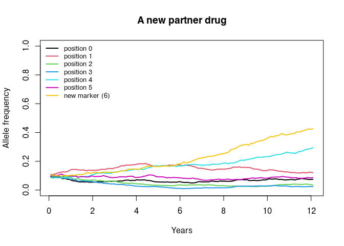

## Overview

`magenta` ships with AL, ASAQ and DHA-PPQ. Sooner or later you will want
something else: a new partner drug, a triple combination, or a drug that works
in a way the existing ones do not.

This vignette works through both cases. The first half shows how to define a
drug that fits the existing framework, which is mostly a matter of supplying the
right numbers to `drug_create()`. The second half takes a drug that **does not**
fit, single low-dose primaquine (SLD-PQ), and uses it to map out exactly where
the model would have to be extended. That second half is intended as the
starting point for a project on modelling SLD-PQ, and it is deliberately
explicit about what the model cannot currently do.


``` r
library(magenta)
```

Read the [resistance vignette](Resistance.html) first; this one assumes you know
what the barcode positions and the efficacy vector are.

---

# Part 1: a drug that fits

Everything `magenta` knows about a drug is in the list returned by
`drug_create()`. To add a new one you need four things:

1. the probability that treatment **succeeds** for each genotype
2. which barcode positions those genotypes correspond to
3. which of those positions shorten post-treatment prophylaxis
4. a curve describing how protection wanes, for sensitive and for resistant
   parasites

Suppose we have a new partner drug whose resistance is conferred by a single
new marker, which we will put at barcode position 6, and which is also
compromised by artemisinin resistance at position 4. That is two resistance
positions, so the efficacy vector has `2^2 = 4` entries, ordered with position 4
as the least significant bit:


``` r
new_drug <- magenta:::drug_create(
  prob_of_lpf = c(0.98,   # wild type at both
                  0.93,   # kelch13 580Y only
                  0.80,   # new partner drug marker only
                  0.55),  # both
  barcode_res_pos = c(4, 6),
  prophylactic_pos = 6,
  dur_P = 30,
  dur_SPC = 7,
  prophylactic_probability =
    1 - pgamma(seq(0, 60, 0.2), shape = 20, rate = 20 / 28),
  prophylactic_resistant_probability =
    1 - pgamma(seq(0, 60, 0.2), shape = 20, rate = 20 / 12)
)
str(new_drug)
## List of 9
##  $ lpf                   : num [1:4] 0.98 0.93 0.8 0.55
##  $ barcode_positions     : num [1:2] 4 6
##  $ prophylactic_positions: num 6
##  $ dur_P                 : num 30
##  $ dur_SPC               : num 7
##  $ hill_n                : num 5.71
##  $ hill_kA               : num 0.263
##  $ hill_res_n            : num 13.3
##  $ hill_res_kA           : num 0.564
##  - attr(*, "class")= chr [1:3] "magenta_drug" "magenta_param_list" "list"
```

The two protection curves say that the drug protects for about 28 days against
a sensitive parasite and about 12 days against one carrying the new marker.
`drug_create()` fits the Hill parameters to those curves for you.

The barcode now has to be long enough to contain position 6, so `num_loci` goes
up to 7 and the fitness cost table with it:


``` r
dl_new <- drug_list_create(
  resistance_flag = TRUE,
  number_of_resistance_loci = 7,
  artemisinin_loci = 4,
  cost_of_resistance = rep(1, 7),
  drugs = list(new_drug),
  number_of_drugs = 1,
  partner_drug_ratios = 1
)

dl_new$resistance_loci
## [1] 4 6

out_new <- pipeline(
  EIR = 10, N = 2000, years = 12, ft = 0.4,
  num_loci = 7, plaf = rep(0.1, 7),
  update_length = 30, update_save = TRUE,
  output = save_summary(genetics = "allele_freqs"),
  drug_list = dl_new, seed = 1L
)
## Seed set to 1
## magenta v1.4.0
## Starting Stochastic Simulation for 12 years
```


``` r
pos <- seq_len(length(out_new$output) - 1)
af <- do.call(rbind, lapply(out_new$output[pos], "[[", "af"))
colnames(af) <- c(paste("position", 0:5), "new marker (6)")
years <- seq_len(nrow(af)) / 12

matplot(years, af, type = "l", lty = 1, lwd = 2, col = seq_len(ncol(af)),
        ylim = c(0, 1), xlab = "Years", ylab = "Allele frequency",
        main = "A new partner drug")
legend("topleft", legend = colnames(af), col = seq_len(ncol(af)),
       lty = 1, lwd = 2, bty = "n", cex = 0.8)
```

<!-- -->

The new marker is strongly selected and kelch13 rises more slowly, which is what
the efficacy table asks for. Defining a drug is really this easy, **provided
the drug acts by curing infections**.

---

# Part 2: a drug that does not fit

## What single low-dose primaquine does

SLD-PQ is a single 0.25 mg/kg dose of primaquine given alongside an ACT. It is
not there to cure the patient; the ACT does that. It is there to stop the
patient infecting mosquitoes.

The World Health Organization recommended it in 2012, set out in the 2015
policy brief *Single-dose primaquine as a gametocytocide in Plasmodium
falciparum malaria* (WHO/HTM/GMP/2015.1), for low-transmission settings and for
areas threatened by artemisinin resistance, with no requirement for G6PD
testing at that dose. Pregnant women are excluded; the infant age cut-off has
been revised since the 2015 brief, so check the current guideline before
choosing an age restriction to model.

The mechanism matters for how you would represent it:

* Artemisinins kill immature gametocytes, but mature stage V gametocytes
  already in circulation are largely unaffected. After an ACT, a patient can
  stay infectious to mosquitoes for days to weeks.
* Primaquine acts on those mature gametocytes, and **sterilises them before it
  clears them**. Infectivity collapses well before gametocyte density falls.

That last point is the crucial one. A model that represents SLD-PQ by
accelerating gametocyte clearance will get the timing badly wrong.

### Evidence for parameterisation


Table: Published estimates relevant to parameterising SLD-PQ.

|Quantity                                   |Value                                                       |Source                                |
|:------------------------------------------|:-----------------------------------------------------------|:-------------------------------------|
|Reduction in mosquito infectivity, day 2   |92.6% (95% CI 78.3-100) at 0.25 mg/kg                       |Dicko et al. 2016, Lancet Infect Dis  |
|Reduction in mosquito infection rate, 48 h |100% median with PQ vs 50.4% for DHA-PPQ alone              |Stone et al. 2022, Lancet Microbe     |
|Infectious feeds from day 5 onwards        |2 of 283 feeds infectious                                   |Stepniewska et al. 2022, J Infect Dis |
|Mean time to gametocyte clearance          |7.7 days with PQ vs 19.7 days without                       |Goncalves et al. 2016, BMC Medicine   |
|Gametocyte positivity, day 7 (odds ratio)  |aOR 0.34 (0.22-0.52)                                        |Yilma et al. 2025, Lancet Infect Dis  |
|Residual infectivity after ACT alone       |Partner drug dependent; large after DHA-PPQ, small after AL |Stepniewska et al. 2022, J Infect Dis |


References:
Dicko et al. (2016) [doi:10.1016/S1473-3099(15)00479-X](https://doi.org/10.1016/S1473-3099(15)00479-X);
Goncalves et al. (2016) [doi:10.1186/s12916-016-0581-y](https://doi.org/10.1186/s12916-016-0581-y);
Stone et al. (2022) [doi:10.1016/S2666-5247(21)00192-0](https://doi.org/10.1016/S2666-5247(21)00192-0);
Stepniewska et al. (2022) [doi:10.1093/infdis/jiaa498](https://doi.org/10.1093/infdis/jiaa498);
Yilma et al. (2025) [doi:10.1016/S1473-3099(25)00078-7](https://doi.org/10.1016/S1473-3099(25)00078-7);
Bradley et al. (2018) [doi:10.7554/eLife.34463](https://doi.org/10.7554/eLife.34463) for the
relationship between gametocyte density and mosquito infection.

Two caveats are worth carrying into any analysis. First, **no randomised trial
has demonstrated a community-level transmission effect**; the evidence is all
individual-level infectivity. Second, the **marginal benefit depends strongly on
the partner drug**, because after artemether-lumefantrine post-treatment
infectivity is already close to zero, whereas after DHA-PPQ it is not.

---

## Why the drug object cannot express it

Look again at what a drug is in `magenta`:


``` r
names(magenta:::drug_create_al())
## [1] "lpf"                    "barcode_positions"      "prophylactic_positions"
## [4] "dur_P"                  "dur_SPC"                "hill_n"                
## [7] "hill_kA"                "hill_res_n"             "hill_res_kA"
```

Every one of these fields feeds into one of two things: the probability that
treatment clears the infection (`lpf`, `barcode_positions`), or the probability
that a new infection is blocked afterwards (`prophylactic_positions`, `dur_P`,
the `hill_*` parameters). `dur_SPC` extends how long someone stays in the
treated state.

**There is no field that changes how infectious a treated person is to
mosquitoes.** SLD-PQ does not change cure rates and does not extend
prophylaxis, so setting any combination of these values cannot represent it.

## Where transmission to mosquitoes is decided

Following the code is the quickest way to see where a blocking term would go.
On each day, for every bite, `Simulation_Update_cpp` asks whether the human
infects the mosquito, and only then processes the gametocytes:

```
// src/main_update.cpp
if (population[...].reciprocal_infection_boolean(parameters))
{
  scourge[...].handle_bite(parameters, population[...]);
}
```

* `Person::reciprocal_infection_boolean()` decides **whether** this person
  infects this mosquito. It draws on the infection state (`cD`, `cA`, `cU`,
  `cT`) and, if `absolute_fitness_cost_flag` is on, scales that by the fitness
  of the best strain for asymptomatic and subpatent hosts only.
* `Mosquito::handle_bite()` then decides **which strains** get through, and how
  many oocysts form.

A transmission-blocking drug has to act in the first of these. Anything added to
the second can change the genetic composition of what is transmitted, but not
whether transmission happens.

## What the existing hooks actually do

`magenta` has two parameters that look like they might serve, both held in
`vector_adaptation_list_create()` and both gated on
`gametocyte_sterilisation_flag`:


``` r
str(magenta:::vector_adaptation_list_create(
  vector_adaptation_loci = 4,
  gametocyte_sterilisation_flag = TRUE,
  gametocyte_sterilisation = 0.5,
  oocyst_reduction_by_artemisinin = 0.2
)[c("gametocyte_sterilisation_flag", "gametocyte_sterilisation",
    "oocyst_reduction_by_artemisinin")])
## List of 3
##  $ gametocyte_sterilisation_flag  : logi TRUE
##  $ gametocyte_sterilisation       : num 0.5
##  $ oocyst_reduction_by_artemisinin: num 0.2
```

* **`gametocyte_sterilisation`** multiplies a strain's weight in the pool from
  which gametocytes are drawn, for hosts who are treated or who recently failed
  treatment. It changes **which** strain is transmitted, not whether one is.
* **`oocyst_reduction_by_artemisinin`** multiplies the number of oocysts formed
  when a mosquito bites a recently treated host. Because the result is passed
  through `ceiling()`, at least one oocyst always forms. It reduces the genetic
  diversity of an infection, not its occurrence.

Neither can block transmission, and a simulation shows it. Below we compare no
blocking, the default blocking parameters, and an extreme setting that reduces
oocysts by 99%:


``` r
dl_al <- drug_list_create(
  resistance_flag = TRUE, number_of_resistance_loci = 6, artemisinin_loci = 4,
  cost_of_resistance = rep(1, 6), drugs = list(magenta:::drug_create_al()),
  number_of_drugs = 1, partner_drug_ratios = 1
)

run_block <- function(va, seed = 1L) {
  out <- pipeline(EIR = 20, N = 3000, years = 12, ft = 0.6,
                  num_loci = 6, plaf = rep(0.1, 6),
                  update_length = 30, update_save = TRUE,
                  output = save_summary(genetics = "allele_freqs"),
                  drug_list = dl_al, vector_adaptation_list = va, seed = seed)
  p <- seq_len(length(out$output) - 1)
  mean(tail(unlist(lapply(out$output[p], "[[", "micro_2_10")), 24))
}

va <- function(...) magenta:::vector_adaptation_list_create(
  vector_adaptation_loci = 4, ...)

data.frame(
  scenario = c("no blocking", "default blocking", "99% oocyst reduction"),
  pfpr_2_10 = c(
    run_block(va()),
    run_block(va(gametocyte_sterilisation_flag = TRUE,
                 gametocyte_sterilisation = 0.5,
                 oocyst_reduction_by_artemisinin = 0.2)),
    run_block(va(gametocyte_sterilisation_flag = TRUE,
                 gametocyte_sterilisation = 0.5,
                 oocyst_reduction_by_artemisinin = 0.01))
  )
)
## Seed set to 1
## magenta v1.4.0
## Starting Stochastic Simulation for 12 years
## Seed set to 1
## magenta v1.4.0
## Starting Stochastic Simulation for 12 years
## Seed set to 1
## magenta v1.4.0
## Starting Stochastic Simulation for 12 years
##               scenario pfpr_2_10
## 1          no blocking 0.4447921
## 2     default blocking 0.4456503
## 3 99% oocyst reduction 0.4348484
```

Even a 99% reduction in oocysts barely moves prevalence, because the mosquito
still becomes infected. This is the empirical confirmation that the existing
hooks are not a transmission-blocking mechanism.

### Two things to be aware of in the current implementation

While tracing this, two discrepancies came to light that anyone using these
parameters should know about.

1. In `src/person.cpp`, the sterilisation multiplier is applied to strains that
   are resistant at **all** `artemisinin_loci`. The comment immediately above
   it, and the documentation of `gametocyte_sterilisation`, both describe the
   opposite intent, namely that the **wild type** contribution should be
   reduced because artemisinin sterilises sensitive gametocytes. As written,
   the code advantages the sensitive parasite rather than the resistant one.
2. In `src/mosquito.cpp`, the reduction is written back into the shared
   pre-drawn oocyst frequency vector rather than applied to a copy, so the
   reduced value persists for later mosquitoes that reuse that element until
   the vector is regenerated at the start of the next year.

Both only matter when `gametocyte_sterilisation_flag = TRUE`, which is off by
default, so existing results are unaffected. They have been left unchanged here
because fixing either one changes model behaviour, which is a decision for the
package maintainer rather than a documentation change.

---

## What would need to be added

Representing SLD-PQ properly is a small, well-contained extension. The pieces
are:

**1. A transmission-blocking term on the drug.** Add two fields to
`drug_create()`:


``` r
drug_create(
  ...,
  transmission_blocking = 0.05,        # relative infectivity after the dose
  dur_transmission_blocking = 14       # days over which it applies
)
```

A value of `0.05` means a treated person is 5% as likely to infect a biting
mosquito as they would otherwise be. Because sterilisation is fast,
a step function over `dur_transmission_blocking` days is a reasonable first
approximation; the data in the table above would support a short ramp over the
first 48 hours if that turns out to matter.

**2. Carry the fields into C++.** They travel the same route as every other
drug property: `drug_create()` to `drug_list_create()`, through
`param_list_simulation_init_create()`, into the `Drug` class in `src/drug.h`
alongside `m_dur_P` and `m_dur_SPC`, with matching entries in
`drug_to_rcpp_list()` and the list constructor so that saved states round-trip.

**3. Apply it at the point of transmission.** In
`Person::reciprocal_infection_boolean()` in `src/person.cpp`, scale the
probability of infecting the mosquito when the person was treated recently:

```
// sketch, not current code
if (parameters.g_current_time - m_day_last_treated <
      parameters.g_drugs[m_drug_choice].get_m_dur_transmission_blocking()) {
  infectivity *= parameters.g_drugs[m_drug_choice].get_m_transmission_blocking();
}
```

`m_day_last_treated` and `m_drug_choice` are already tracked per person, and
both are already saved and restored, so no new per-person state is needed. That
is what makes this extension cheap.

**4. Decide what happens on treatment failure.** The dose is given with the
ACT, so it should block transmission even when the schizonticide fails. That
means keying the effect off `m_day_last_treated` rather than off the infection
state, which the sketch above does.

**5. Represent coverage separately from `ft`.** SLD-PQ is given to a subset of
treated patients. The simplest approach is a per-drug coverage probability
drawn at treatment, so that an AL plus SLD-PQ policy becomes a second drug in
an MFT list with the same efficacy table and a blocking term, deployed at
whatever coverage is being modelled. That reuses the existing
`partner_drug_ratios` machinery and needs no further code.

### What would still be missing

Two simplifications are worth stating in any write-up.

* `magenta` does not track gametocyte density, only whether a strain is
  gametocytogenic. The relationship between gametocyte density and the
  probability a mosquito is infected (Bradley et al. 2018) therefore cannot be
  represented, and a blocking multiplier is a summary of it rather than a
  mechanistic description.
* The partner drug's own gametocytocidal activity is not represented either, so
  the difference between adding SLD-PQ to AL and adding it to DHA-PPQ would
  have to be put in by hand, through different baseline infectivity for
  treated hosts under each drug.

---

## Questions a project could answer

With the extension above, these become tractable:

1. **How much does SLD-PQ reduce transmission, and where?** WHO restricts the
   recommendation to low transmission settings on the grounds that treated
   symptomatic cases are too small a share of the infectious reservoir at high
   transmission. `magenta` tracks the whole reservoir by infection state, so
   this is directly testable across a range of EIR.
2. **Does it slow resistance?** This is the argument in the 2015 policy brief,
   and it has never been tested in a trial. Resistant parasites gain a
   transmission advantage partly through slow parasite clearance, which
   lengthens the infectious window. A gametocytocide that acts regardless of
   genotype should erode that advantage. The model already has both halves of
   that mechanism.
3. **How does the benefit depend on the partner drug and on coverage?** Varying
   baseline post-treatment infectivity and SLD-PQ coverage separately maps out
   where the policy is worth deploying.
4. **What does it do to parasite genetic diversity?** Blocking transmission from
   treated hosts removes a non-random slice of the parasite population, which
   should show up in complexity of infection and in the measures described in
   the [model output vignette](Loggers.html).

A sensible order of work is: implement the blocking term and check it behaves
(infectivity should drop to the expected multiplier), reproduce the
individual-level infectivity numbers in the table above as a calibration check,
and only then run population-level scenarios.

---

## Where next

* [Simulating antimalarial resistance](Resistance.html) for the resistance
  machinery this builds on.
* [Drug strategies](DrugStrategies.html) for deploying more than one drug, which
  is how an SLD-PQ policy would be rolled out.
* [Model output](Loggers.html) for extracting transmission and genetic
  summaries.
